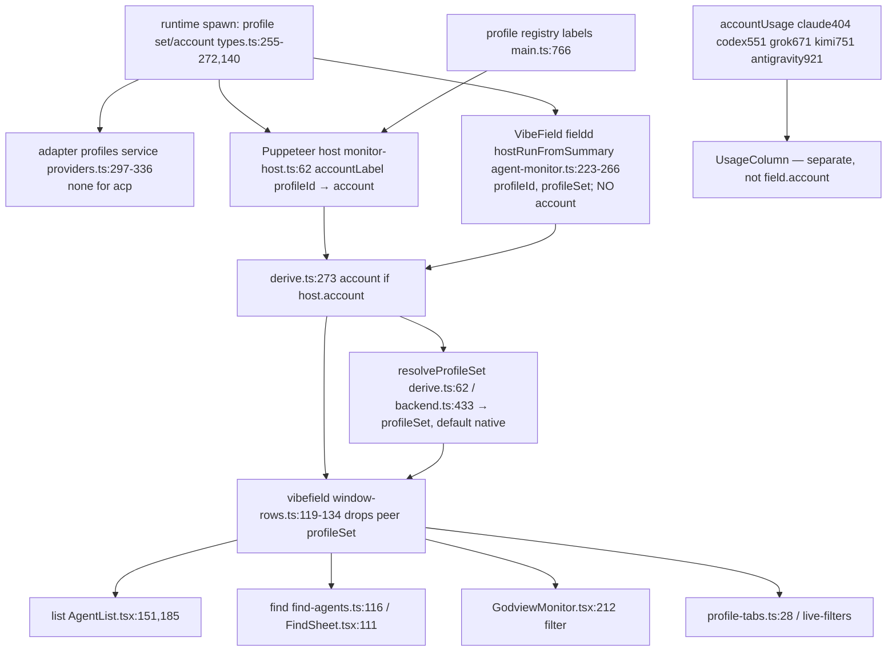

# Account trace — `field.account`, `field.profileSet`

Static read only. puppeteer `748d015`, vibefield `433505f`. Nothing was run live.

## Contract fields
- `field.account` (model.schema.json:8092): `AgentView.account?: string` (view-sdk/src/model.ts:156). Default: absent.
- `field.profileSet` (model.schema.json:12796): `AgentView.profileSet`. No other account field exists (`profileId` is host-only and never reaches a row).

## Path
1. Runtime: spawn picks the profile set/account (runtime/src/types.ts:255-272). Run info carries `profile?: AgentProfile` (types.ts:140) and `LaunchEnvironmentRequest{profileSetId, profileId?}` (types.ts:550-554). Profiles are persisted by `ProfileRegistrySnapshot` (types.ts:569-577).
2. Per-adapter `profiles:` services (builtin-providers/src/providers.ts:297-336 and 401/548/668/748/834/918/1014/1101/1182): claude, codex, grok, kimi, opencode, hermes, antigravity, copilot, pi. **ACP has none** (providers.ts:643-644). Adapters never emit an account through `usage`/events. Binding is runtime/host-side only.
3. `accountUsage` services (providers.ts:404 claude, 551 codex, 671 grok, 751 kimi, 921 antigravity) feed the **usage column** (views/src/usage/account-usage.ts:63-82, `profileLabel`→`accountLabel`; UsageColumn.tsx:123), **not** `AgentView.account`. They are a separate channel.
4. Host port: `MonitorHostRun.profileId/profileSet/account` (monitor/src/backend/ports.ts:61-65).
   - **Puppeteer Godview host**: `account = accountLabel(info.profileId)` (apps/godview/src/main/monitor-host.ts:62,78-79). Labels come from the registry (`main.ts:766` builds `monitorAccountLabels` from profiles; `main.ts:735`). `profileSet` is not supplied.
   - **VibeField fieldd host** `hostRunFromSummary` (fieldd/src/agent-monitor.ts:223-266) copies `profileId` and `profileSet` but **never sets `account`**. No `account` exists anywhere in fieldd/src (rg).
5. Backend derive: `account` is copied verbatim when the host supplies it (monitor/src/backend/derive.ts:273). `profileSet` is always set: `resolveProfileSet` (derive.ts:62-66) uses host.profileSet, then personas[profileId], then `NATIVE_PROFILE_SET`, applied at backend.ts:433. Terminal rows get it only from host.profileSet (derive.ts:317).
6. VibeField window-rows overlay (field-app/src/godview/monitor/window-rows.ts:119-134) strips `profileSet` from peer (non-self) rows and keeps `account` unchanged.
7. Readers:
   - `account`: list view AgentList.tsx:151 (aria name) and :185 (`<small>`); find (views find-model.ts:125, FindSheet.tsx:111, fed by vibefield find-agents.ts:116 for self rows only); vibefield GodviewMonitor.tsx:212 (filter text); Puppeteer chrome-rows.ts:152 and main.tsx:863; lab-model.ts:115.
   - `profileSet`: vibefield profile-tabs.ts:28 and live-filters.

## Per adapter
`field.account`: under the **VibeField host (the audited product) it is unreachable for all 10 adapters**. The host never supplies it (agent-monitor.ts:223-266) and it has no other source, so it is always absent. The list, find and filter readers never show it. Under the **Puppeteer Godview host** it is reachable when a run is bound to a registered profile with a label (monitor-host.ts:62). That holds for claude, codex, grok, kimi, opencode, hermes, antigravity, copilot and pi. It is **unreachable for acp** (no profiles service, so no profileId). In both hosts the adapter itself never produces it.

`field.profileSet`: reachable for all 10 agent rows, because the backend always resolves it. With VibeField, the source is fieldd `summary.profileSet`, then personas[profileId], then `native`. For acp that is always `native`, and the same for any unbound run. Self rows keep it. Peer rows lose it in window-rows.ts:130-134, and readers fall back to their own default.

| adapter | profiles svc | accountUsage | account (VibeField) | account (Puppeteer host) | profileSet |
|---|---|---|---|---|---|
| acp | no | no | absent | absent | native (self rows) |
| antigravity | yes | 921 | absent | profile label if bound | resolved; peer stripped |
| claude | yes | 404 | absent | label if bound | resolved |
| codex | yes | 551 | absent | label if bound | resolved |
| copilot | yes | no | absent | label if bound | resolved |
| grok | yes | 671 | absent | label if bound | resolved |
| hermes | yes | no | absent | label if bound | resolved |
| kimi | yes | 751 | absent | label if bound | resolved |
| opencode | yes | no | absent | label if bound | resolved |
| pi | yes | no | absent | label if bound | resolved |

Verdict for GV-AUDIT3's 5 unknowns: under the VibeField host, `field.account` is **settled as unreachable** (rows don't fill it). It is not unknown. Puppeteer-host reachability is a separate, proven path.
