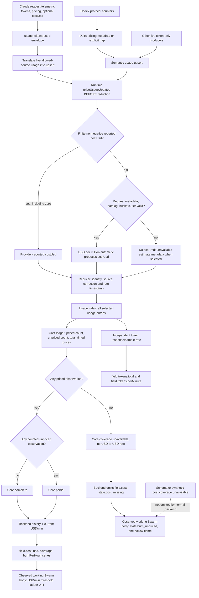

# Cost and burn: producer → runtime pricing → core → row → view

## Scope and decisive corrections

Static source analysis only. No live agents, renders, source-code changes, commits or pushes were performed; this report is the only new artifact.

- Puppeteer checkout `/workspace/gv-audit/src/puppeteer`: `git rev-parse HEAD` verified **748d015a7e393112e0a91dad80111fdf5abe6583**. All Puppeteer paths below are relative to that checkout.
- Consumer `/workspace/vf-push`: branch `audit/godview-model`, HEAD **d53a0fa24ca7341fe5858329c9399eac6baf6b53**; merge-base with consumer pin verified **433505fd0f224f4cda540d642661b13848c0ef82**. Consumer code references below are to this unchanged baseline code, not the audit additions.
- Audit target is **newer Puppeteer source, NOT the 0.3.3 package Vibefield ships**. This report does not assert these source behaviors ship today.
- Stable IDs refer to `contracts/model.schema.json`; no canonical model file was modified.

**Correction 1:** Claude is the only direct adapter `costUsd` producer, but **not the only adapter whose runtime can produce USD**. Runtime ingress consumes Codex `pricing` metadata and derives `costUsd` from a pinned catalog. Claude also has this fallback.

**Correction 2:** Token-only adapters do **not** normally emit the row state `state.cost_unavailable`. Core usage coverage is `unavailable`, but the backend omits the entire row cost object when no priced total exists: **`state.cost_missing`**, with **`state.burn_unpriced`** for an observed working Swarm body. These are different contract predicates.

## 1. Ingestion and pricing boundary

### Event path and batch path

1. `packages/core/src/events/usage.ts:49-62` defines `usage:tokens-used`, optional `pricing`, and finite nonnegative optional `costUsd`.
2. `packages/runtime/src/services/monitor-service.ts:227-253` translates the event envelope and calls `accept`; `packages/core/src/monitor/reduce.ts:1049-1073` turns eligible usage events into usage upserts, copying `pricing`, `cost`, token counters/buckets and `costUsd`. Replay or an unapproved event source is discarded here.
3. Codex and other semantic adapters can emit usage-family upserts directly rather than `usage:tokens-used`: `monitor-service.ts:256-269` accepts semantic batches.
4. Crucially **both runtime and semantic inputs are priced BEFORE reduction**: `monitor-service.ts:418-425` calls `priceUsageUpdates`.
5. `packages/runtime/src/services/usage-pricing.ts:69-78` prices usage upserts only when `permitsLiveUsage(phase, origin)` and at least one of `canonical`, `pricing`, or defined `costUsd` is present. `packages/core/src/monitor/usage-policy.ts:4-21` allows telemetry/protocol/hook sources in live or correction phases. Workspace input does not go through this runtime pricing call.
6. `packages/core/src/monitor/reduce.ts:243` independently rejects usage outside that live/correction allowlist. Stored observation identity, correction and repeated-delivery handling preserve original rate eligibility and time (`reduce.ts:127-162`); a newly stored live usage entry is rate-eligible, a new correction-only entry is not.

### Exact runtime pricing rules

`packages/runtime/src/services/usage-pricing.ts:19-66`:

- Existing finite nonnegative `costUsd`, **including zero**, wins immediately; metadata becomes `basis: api-equivalent`, `source: provider-reported` (24-26).
- Otherwise require `pricing`; reject a gap, missing model ID, or a service tier other than default/standard/auto (27-34).
- Require exact catalog key `${providerId}/${modelId}` (35-36); no fuzzy matching or substitution of the session's latest model.
- Require all four explicit buckets: fresh input, output, cache read, cache creation (37-44).
- For a tiered rate require request context size, and use each ascending tier whose `above` threshold is strictly exceeded (45-50).
- Positive cached tokens require a cache-read rate; positive cache-write tokens are unavailable because their TTL is unknown (51-55).
- `inputUsd = (inputTokens * inputRate + cacheReadTokens * cacheReadRate) / 1_000_000`; `outputUsd = outputTokens * outputRate / 1_000_000`; write their sum as `costUsd`, with source `catalog` and catalog version (56-66). Reasoning tokens are not added again to output pricing.
- On any rejection remove `costUsd` and retain a `cost` object with `source: unavailable` and a specific reason (20-23). This is estimate metadata, NOT a row `MonitorCost`.

`packages/runtime/src/services/usage-prices.ts:23-39` documents USD/million-token units and the pinned catalog/supplement version. Examples: `openai/gpt-5` at 92-96; Codex-specific catalog keys at 135-144. This is a static reference/API-equivalent estimate, **not billing/account spend**.

### Claude producer

`packages/adapter-claude/src/observation/otel/usage.ts:28-79` accepts request-completion telemetry, produces a canonical response usage identity, reports token buckets and `pricing` provider `anthropic`, and copies native `cost_usd` when valid. `observation/otel/wire.ts:154-161` accepts finite nonnegative numbers or numeric strings, including 0; invalid costs are omitted. Records with neither any tokens nor valid cost are ignored. When native cost is missing, sufficiently complete Claude pricing buckets/model can still be catalog-priced by runtime. Missing cache-write TTL prevents that fallback only when writes are positive; a valid provider-reported cost wins before this restriction.

### Codex producer: pricing IS consumed

`packages/adapter-codex/src/normalization/monitor.ts:477-527` emits live, nonduplicate protocol usage samples with cumulative tokens, `canonical: false`, and `pricing` when total is positive or a previous counter exists. It never directly supplies `costUsd`.

`normalization/usage.ts:28-64` calculates request/delta billable buckets, not just a UI counter:

- no previous counter → gap `baseline`;
- total decreases → `counter-reset`;
- model changes → `model-change`;
- missing/invalid bucket deltas, cached > input, or input+output unequal to total delta → `incomplete-buckets`;
- otherwise fresh input = input delta minus cached delta; output = output delta (reasoning already included); cache creation = 0; context supplied only when last-request counters prove this delta is one request.

Model/provider/tier are captured from protocol settings (`monitor.ts:307-311, 551-558`, model revisions 124-144), not guessed at price time. These upserts pass through the semantic ingress pricing call above. **The core cost ledger itself does not read the pricing catalog; it reads the `costUsd` runtime already derived.**

Codex can be complete: first live sample is an all-zero counter, so no pricing/gap metadata is emitted; next same-model valid complete delta is catalog-priced. The metadata-free zero baseline is not counted as unpriced. A positive first baseline is unpriced; later valid prices then make coverage partial. Not every actual Codex session is priceable: provider/model mismatches, unknown or tiered context, unsupported service tiers and gaps all matter.

## 2. Core cost ledger and exact coverage

`packages/core/src/monitor/usage-index.ts:321-330, 427` constructs the run stream from all selected usage entries; `stream` calls `buildUsageCostLedger` (210-223). Cost does **not** require `canonical: true`: noncanonical Codex sample costs count. Identity selection/correction happens before this fold, not by summing UI snapshot differences.

`packages/core/src/monitor/cost.ts:21-40`:

- Valid priced observation iff `costUsd` is defined, finite, and >= 0. Count it and add it to the total.
- **Yes, missing/invalid/negative `costUsd` is skipped for USD sum, priced count, history and rate.** However it increments `unpriced` iff `canonical || pricing || cost` is truthy. A plain noncanonical token sample without those metadata is skipped without incrementing unpriced.
- A priced observation contributes to timed rate/history only when its stored entry is rate-eligible and its timestamp is finite. An untimed/ineligible price can still contribute to total/coverage.

`projectUsageCost`, `cost.ts:59-101`, gives these **core usage** predicates:

| Core usage coverage | Exact predicate | USD and USD/minute |
|---|---|---|
| complete | priced > 0 and unpriced = 0 | emitted; total may be 0 |
| partial | priced > 0 and unpriced > 0 | emitted; sum of priced subset only |
| unavailable | priced = 0, regardless of unpriced | both omitted, history empty |

USD/minute = sum of priced, rate-eligible amounts whose timestamps satisfy **asOf-window < time <= asOf**, multiplied by 60,000/windowMs. If any price exists but no qualifying recent amounts exist, it is **0**, not unavailable. History has twenty 30-second buckets; split input/output values are retained only where evidence supports the split (`cost.ts:67-100`). No price is inferred by this ledger.

`packages/core/src/monitor/rate.ts:6,15-20` defaults the shared window to 60,000 ms. `usage-index.ts:531-550` projects run/actor cost and token-rate outputs; `project.ts:347-351,417` puts the usage projection into monitor state. `monitor-spi.ts:15` exports the rate SPI, not a separate calculator. `monitor-service.ts:539-543` schedules rate expiry; the clock can change rates without new usage.

## 3. Row fields: core unavailable is NOT row unavailable

`packages/monitor/src/backend/backend.ts:404-435` observes monitor usage into the backend `UsageLedger`, then calls `costOf`.

- `packages/monitor/src/backend/usage-ledger.ts:62-82,98-118` retains corrected per-run `costUsd`, coverage and buckets; sums priced totals, marks any retained non-complete run as partial, and produces unavailable only when no retained total exists.
- `backend.ts:190-207`: if history total is undefined, return **undefined**, NOT `{coverage: unavailable}`. Otherwise emit:
  - `field.cost.usd` = history total;
  - `field.cost.coverage` = history coverage;
  - `field.cost.burnPerHour` = current core `costRatePerMin * 60`, if defined;
  - `field.cost.series.{stepMs,steps,lastStepAt}` = ledger bucket grid.
- `derive.ts:275-278` only adds `field.cost` if that object exists.
- Consequently normal backend rows can emit **complete or partial**, never a present cost object with coverage unavailable. `state.cost_unavailable` is schema/fixture/remote-input representable, but **not reachable from this normal backend cost mapping for ANY adapter**.
- `state.cost_missing` is `field.cost` absent; this is where token-only adapters land, even when their **core usage** coverage reads unavailable.
- With backend epoch accumulation enabled, a retained earlier unpriced run can make an otherwise fully priced current run partial (`backend.ts:404-422`; `usage-ledger.ts:67-78`). This does not create a price for an unpriced adapter.

Consumer: `/workspace/vf-push/packages/fieldd/src/agent-monitor.ts:461-480` delegates to Puppeteer's backend, explicitly using `cost: {acrossEpochs: current}`. No separate consumer token-to-USD step is applied here.

## 4. Two different burn rates

### Token meter (not the flame ladder)

`packages/core/src/monitor/usage-index.ts:110-128,453-483,521-550`:

- Canonical response meter uses explicit `meterTokens`, else total/delta/buckets; sums eligible in-window meter contributions and scales to tokens/minute.
- If no response rate exists, cumulative sample rate needs >= 2 dated samples and a rate-eligible later sample; adds only positive counter deltas, scales by elapsed sample time clamped to [1 ms, windowMs]. Actor-only sample streams can be summed.
- An actual zero measured rate is distinct from missing rate. No USD prices are consulted.
- `packages/monitor/src/backend/derive.ts:198-207` maps cumulative tokens → `field.tokens.total`, token burn/minute → `field.tokens.perMinute`, and omits `field.tokens` only if both absent.
- Claude, Codex, Grok, Hermes and OpenCode have traced live token producers; ACP, Antigravity, Copilot, Kimi and Pi do not provide a live consumption producer at this pin. This is a producer-path conclusion, not just a capability-table label.

### Priced Swarm flames (USD, not tokens)

`packages/views/src/views/swarm/bubble-model.ts:469-477,523` uses the observed working body cost only. Complete/partial coverage → priced; missing/unavailable → unpriced. Missing `burnPerHour` with priced coverage defaults to 0. Per-hour rate is divided by 60 with precision normalization (`288-290`).

`bubble-model.ts:60-66` defines thresholds `[0.05, 0.15, 0.4, 1]` **USD/minute**, inclusive at each threshold:

| Contract state | Working, observed body's predicate |
|---|---|
| state.burn_flames_0 | priced; 0 <= rate < 0.05 USD/min |
| state.burn_flames_1 | priced; 0.05 <= rate < 0.15 |
| state.burn_flames_2 | priced; 0.15 <= rate < 0.4 |
| state.burn_flames_3 | priced; 0.4 <= rate < 1 |
| state.burn_flames_4 | priced; rate >= 1 |
| state.burn_unpriced | no observed complete/partial cost; `priced=false`, lit=0; one hollow flame |

`packages/views/src/views/swarm/body-layout.ts:95-99` draws lit flames when priced, one hollow flame otherwise; `gpu/swarm-renderer.ts:669-674` selects solid/hollow glyphs. No token-to-flame conversion exists. Idle/blocked bodies do not use this working-body flame branch. An unobserved working row has evidence suppressed (`bubble-model.ts:268-270`) and therefore cannot show priced burn simply because an input row contains a cost.

## 5. Reachability by adapter (standard native producers + runtime + backend)

“Can” means source permits a satisfying input sequence; **not** that telemetry/catalog inputs were observed in a live run. It excludes injected/seeded remote rows, synthetic fixtures and hypothetical future producer changes. Cost state columns are **row contract** states; core unavailable is a separate column. Priced flame columns additionally require an observed working body and rate-eligible/time-window evidence. All 0–4 flame tiers are possible for a priceable producer given suitable amounts; no source upper bound prevents a threshold.

| adapter | core coverage unavailable possible | state.cost_complete | state.cost_partial | state.cost_unavailable (present row object) | state.cost_missing / state.burn_unpriced | state.burn_flames_0..4 |
|---|---|---|---|---|---|---|
| claude | yes, before prices or with only unpriceable observations | can | can, mixture of priced/unpriced requests | no via normal backend | can | can, provider cost or catalog fallback |
| codex | yes, before prices or gaps/unknown catalog inputs only | can, clean zero baseline then priceable deltas | can, positive baseline/gaps plus priceable deltas | no via normal backend | can | can, runtime catalog prices |
| acp | yes | no from current producers | no from current producers | no via normal backend | can | no from current producers |
| antigravity | yes | no from current producers | no from current producers | no via normal backend | can | no from current producers |
| copilot | yes | no from current producers | no from current producers | no via normal backend | can | no from current producers |
| grok | yes | no from current producers | no from current producers | no via normal backend | can | no from current producers |
| hermes | yes | no from current producers | no from current producers | no via normal backend | can | no from current producers |
| kimi | yes | no from current producers | no from current producers | no via normal backend | can | no from current producers |
| opencode | yes | no from current producers | no from current producers | no via normal backend | can | no from current producers |
| pi | yes | no from current producers | no from current producers | no via normal backend | can | no from current producers |

Producer checks supporting the negative cells:

- Grok `packages/adapter-grok/src/normalization/usage.ts:24-54`: token reader and canonical response upsert copy no request pricing or USD. Runtime tags these as unpriceable (canonical gate), so core unpriced count rises.
- Hermes `packages/adapter-hermes/src/normalization/monitor.ts:305-322,698-709`: noncanonical cumulative token samples, no pricing/USD; they are not even selected for `priceUsageUpdates` absent other metadata, so unpriced count can remain zero while core coverage is still unavailable (priced=0).
- OpenCode `packages/adapter-opencode/src/normalization/monitor.ts:108-153`: token buckets/delta, canonical response upsert, no pricing/USD. Token buckets alone do not supply provider/model/request pricing metadata; runtime does not reconstruct it from the row model.
- ACP `packages/adapter-acp/src/normalization/monitor.ts:216-228`: native usage_update produces context used/capacity, **not** live usage or USD.
- Kimi `packages/adapter-kimi/src/normalization/monitor.ts:372-396`: usage.record journal data only creates context; explicitly never live consumption.
- Antigravity, Copilot and Pi: searches across their `src` for `pricing`/`costUsd` and their monitor normalizers for usage upserts found no live cost producer; their usage capability exclusions explain the excluded rails (`adapter-antigravity/.../monitor-capabilities.ts:15-23`, `adapter-copilot/.../monitor-capabilities.ts:15-23`, `adapter-pi/.../monitor-capabilities.ts:16-24`). No capability declaration is used as the sole reachability proof.

## 6. Pricing search boundary: Puppeteer and Vibefield

Searches covered `price`, `pricing`, `perMillion`, `per_million`, USD/cost fields and million-token arithmetic in the checked-out source, including `.ts/.tsx/.js/.mjs/.rs/.swift` consumer files. The operative Puppeteer catalog conversion is `runtime/src/services/usage-pricing.ts` + `usage-prices.ts` above; the core fold only aggregates its result. Adapter model/inventory price references and vendor documentation are not extra ingress calculators.

No additional **production token-to-USD conversion feeding these monitor rows** was found in the Vibefield checkout. Its native/Swift monitor views read owner-supplied costs, not price tokens. Distinguish these unrelated search hits:

- Consumer mirror `/workspace/vf-push/packages/fieldd/src/agent-field.ts:803-810` copies core cost/coverage; no estimate is synthesized.
- Historical index uses upstream **Rosetta-provided** list-price values: `packages/fieldd/src/index-timeline.ts:397-421` copies priced `micro_usd`; contracts `packages/contracts/src/agent-index.ts:1617,2328,2477` document imported pricing. Rosetta's own implementation is external to these checkouts; its internal calculation is not established here and no path from its historical cost into this core monitor ledger was found.
- Consumer mock/perf code does contain synthetic token-price multiplications (`apps/ios/VibeFieldKit/Sources/FieldAgents/MockAgentField.swift:208,323`; `packages/field-app/src/godview/monitor/perf/corpus.ts:323,355`). Those do not make native adapter states reachable.

## 7. Mermaid end-to-end flow

## Validation / handoff

Read-only static proof with file:line citations; no runtime tests or renders executed in this task. Existing runtime test source independently demonstrates catalog pricing of a noncanonical native sample and rate expiry (`packages/runtime/src/services/monitor-service.test.ts:129-179`), but is not presented as a newly executed test. The canonical contract already distinguishes missing vs unavailable (`contracts/model.md:172-186`). Preserve that distinction in adapter evidence and coverage validation. In particular, revise any “only Claude can have priced burn” or “token-only means row cost_unavailable” downstream claims.
