# Shared downstream signal join

**Puppeteer 748d015 source — NEWER THAN SHIPPED VIBEFIELD 0.3.3.** Consumer code 433505f. Static source reading, no execution/renders, no commits.

The supplied /workspace/gv-audit/src is a container; the actual verified git checkout is src/puppeteer. Every listed candidate state is a conditional recomputation with concurrent evidence and host/window facts, not a guaranteed effect of one event. Semantic message and event message paths differ (a semantic message alone does not open responding).

## Counts and interpretation

```json
{
  "normalizedEvents": 37,
  "semanticValueKinds": 13,
  "rowFieldContinuations": 74,
  "statePredicates": 82,
  "rowJoinAnchorsResolved": 370,
  "rowJoinAnchorsUnresolved": 0,
  "statePlaceholdersMapped": 410,
  "comparisonIssues": 3,
  "rendererSetDifferences": 0
}
```

370 row continuation placeholders are filled. Zero missing shared continuation paths. The 410 state placeholders now reference predicate paths, but this does NOT claim 410 adapter-specific reachable cases. Producer-specific sequences remain conditional except the explicit cost/invalid-blocker verdicts. No original producer evidence was rewritten. All 74 row fields include defaults, merge references, window effects and renderer/no-direct-reader outcomes.

## Common ordered path

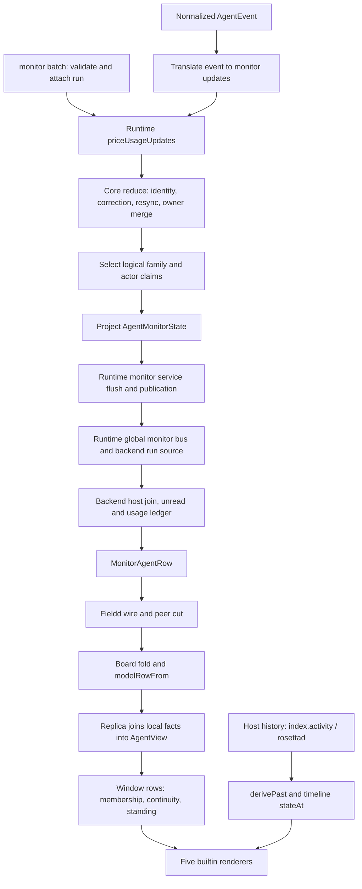

### eventIngress — AgentMonitorService.consume / acceptAgentEvent

monitor:batch goes to semantic ingress; other events are translated. Non-host process/session exits cannot change monitor liveness. Zero-update events are dropped (not an evidence/recency tick).

puppeteer:packages/runtime/src/services/monitor-service.ts:176-188; puppeteer:packages/runtime/src/services/monitor-service.ts:227-253

### batchIngress — AgentMonitorService.acceptSemantic

Strict schema parse, runtime run/epoch attached, then accept. consume excludes usage on replay/non-live source before this call.

puppeteer:packages/runtime/src/services/monitor-service.ts:176-184; puppeteer:packages/runtime/src/services/monitor-service.ts:256-269; puppeteer:packages/core/src/events/monitor.ts:213-305

### pricing — priceUsageUpdates BEFORE reduceMonitorAccumulator

Live/correction allowed-origin usage upserts with canonical/pricing/costUsd: valid reported nonnegative USD incl zero wins; otherwise exact request model/catalog/buckets/tier pricing. Missing metadata is not reconstructed from row/session model. Failed estimate has no USD.

puppeteer:packages/runtime/src/services/monitor-service.ts:418-425; puppeteer:packages/runtime/src/services/usage-pricing.ts:19-78; puppeteer:packages/core/src/monitor/usage-policy.ts:4-21

### reducer — reduceMonitorAccumulator / applyUpdates

Reject wrong run/epoch, duplicate source event/batch, retired or unordered semantic epoch. Storage owner/epoch/scope identity; upsert replaces except run nativeSession/failure retained and environment partial merge. Complete replace deletes only owned family slice; partial replace adds/corrects, retract removes own key. Usage disallows replace and bootstrap/resync; corrections/repeated identity preserve rate timestamp/eligibility. Resync stages until ready; complete barrier replaces producer slice, not usage ledger.

puppeteer:packages/core/src/monitor/reduce.ts:100-162; puppeteer:packages/core/src/monitor/reduce.ts:229-295; puppeteer:packages/core/src/monitor/reduce.ts:378-409; puppeteer:packages/core/src/monitor/reduce.ts:487-604; puppeteer:packages/core/src/monitor/reduce.ts:672-686

### selection — selectClaims

Logical family identity includes actor and intent where appropriate, NOT arbitrary raw key alone. Nonprovisional wins first; metric/actor selection quality then time then plane; other families plane then quality then time. Runtime run/liveness authority; workspace environment priority. Child/root attribution never interchangeable.

puppeteer:packages/core/src/monitor/selection.ts:22-52; puppeteer:packages/core/src/monitor/selection.ts:94-140

### publication — AgentMonitorService.flush / publishState

Project only at flush; previous preserves statusSince until status changes and revision only changes for a public difference. 100ms default coalescing; liveness/blocker/session/readiness urgent; activity leases default 5s. USD/token-rate boundary timer and freshness boundary can publish with no new adapter event.

puppeteer:packages/core/src/monitor/project.ts:398-449; puppeteer:packages/runtime/src/services/monitor-service.ts:34-36; puppeteer:packages/runtime/src/services/monitor-service.ts:418-489; puppeteer:packages/runtime/src/services/monitor-service.ts:501-586

### runtimeBus — runtime monitor source to backend

onState fans out through runtime global monitor bus; subscribe-before-list backend store. This is AgentMonitorState, not detailed Agent state.

puppeteer:packages/runtime/src/runtime.ts:1146-1185; puppeteer:packages/runtime/src/runtime.ts:4029-4055; puppeteer:packages/monitor/src/backend/runtime-source.ts:27-55; puppeteer:packages/monitor/src/backend/backend.ts:491-517

### row — deriveAgentRow / backend reconciliation

Join host identity/defaults with projected state; usage ledger cost is separate injected input. Host pending forces idle/unobserved; missing state working+starting; host false liveness overrides state. Backend visibility/removal and unread are not adapter emissions.

puppeteer:packages/monitor/src/backend/derive.ts:68-112; puppeteer:packages/monitor/src/backend/derive.ts:240-286; puppeteer:packages/monitor/src/backend/backend.ts:316-442

### wire — fieldd backend / wire / peer audience cut

Consumer backend uses cost acrossEpochs=current. Wire removes device.self; peer drops project.seq and bounds detail/activity/wait/reply text; cost is not recomputed.

vibefield:packages/fieldd/src/agent-monitor.ts:461-493; vibefield:packages/fieldd/src/agent-field.ts:586-596; vibefield:packages/fieldd/src/agent-field.ts:664-700

### board — modelRowFrom and board fold

Restore device.self from receiving device identity; writable absent falls back to attachable; per-device snapshots replace that slice, deltas update rows, not additive field merging.

vibefield:packages/field-app/src/godview/monitor/model-board.ts:112-123; vibefield:packages/field-app/src/godview/monitor/model-board.ts:190-296

### replica — replica.join => AgentView

Spread row; join colour from seq, active/receded, attachment, spawnHint, visualId. Terminal-only local activity/status override with independent status clock; agent status/activity unchanged.

puppeteer:packages/monitor/src/replica/replica.ts:245-277; puppeteer:packages/monitor/src/replica/replica.ts:281-373

### window — createWindowRows.rowsFor

Order facts first then remaining rows, suppress transition membership, calculate visual continuity, first body per visual identity wins. Peer stale = standing != live; remove peer profileSet. All other business fields spread unchanged. Device filter may remove rows; no second cost/status calculator.

vibefield:packages/field-app/src/godview/monitor/window-rows.ts:76-151; vibefield:packages/field-app/src/godview/monitor/window-rows.ts:304-311; vibefield:packages/field-app/src/godview/monitor/useMonitorAgents.ts:380-402

## Updated GV-AUDIT3 UI gaps and Claude total-token resolution

Input join is artifact commit 5195c56 (gv-audit3-joined), not the older partial reviewed export. Source-permitted state verdicts from that newer input are preserved, with shared downstream citations added.

```json
{
  "ui": {
    "originalUnknown": 265,
    "resolvedUnknown": 265,
    "remainingUnknown": 0,
    "directYes": 285,
    "indirectOnly": 20,
    "noUiConsumer": 65
  },
  "stateVerdicts": {
    "originalUnknown": 35,
    "remainingUnknown": 0
  }
}
```

UI reachability is deliberately separated from producer reachability: a downstream cost reader exists even when an adapter supplies no USD; a host-owned colour can reach UI although adapters do not emit colour. Direct no-reader and indirect visual/control effects have separate flags.

### Claude totalTokens -> tokens.total

With at least one token bucket, Claude emits canonical response totalTokens (including zero); totalContribution returns totalTokens; buildUsageIndex sums canonical contributions into cumulativeTokens; queryUsageIndex publishes usage.cumulativeTokens; derive agentTokens copies it to tokens.total. No adapter cumulativeTokens is required. Cost-only request omits token total; replay/disallowed origin is rejected; dedupe and correction are by usage identity, not snapshot sums.

- **Claude OTLP normalization**: totalTokens=sum known buckets with missing buckets zero-filled only when at least one exists; canonical=true, response; no token total on cost-only event puppeteer:packages/adapter-claude/src/observation/otel/usage.ts:28-79
- **Event ingestion**: Allowed live source and nonreplay event copies totalTokens; runtime pricing may add USD without replacing the token total puppeteer:packages/runtime/src/services/monitor-service.ts:227-253; puppeteer:packages/core/src/monitor/reduce.ts:1049-1073; puppeteer:packages/runtime/src/services/monitor-service.ts:418-425
- **Usage identity and selection**: Reducer ledger retains unique/corrected observations and selectClaims chooses usageId once puppeteer:packages/core/src/monitor/reduce.ts:239-259; puppeteer:packages/core/src/monitor/selection.ts:103-106; puppeteer:packages/core/src/monitor/usage-index.ts:577-602
- **Canonical request total -> run cumulative**: totalContribution uses finite nonnegative totalTokens first. Canonical contributions fold running+=amount and set cumulativeTokens=running, including actual zero puppeteer:packages/core/src/monitor/usage-index.ts:110-128; puppeteer:packages/core/src/monitor/usage-index.ts:321-325; puppeteer:packages/core/src/monitor/usage-index.ts:345-366
- **Public monitor -> row**: queryUsageIndex publishes cumulativeTokens; project attaches usage; agentTokens copies usage.cumulativeTokens as total puppeteer:packages/core/src/monitor/usage-index.ts:545-550; puppeteer:packages/core/src/monitor/project.ts:417; puppeteer:packages/monitor/src/backend/derive.ts:198-207; puppeteer:packages/monitor/src/backend/derive.ts:278
- **Transport / overlay / view**: row spreads unchanged through wire/board/replica/window; five builtin production views do not read row.tokens; no flames from these tokens vibefield:packages/field-app/src/godview/monitor/model-board.ts:112-123; puppeteer:packages/monitor/src/replica/replica.ts:362-373; vibefield:packages/field-app/src/godview/monitor/window-rows.ts:130-136

No direct builtin renderer reads tokens.total or tokens.perMinute. USD flames consume cost, not this total.

## Every normalized event

| event | continuation group | translation evidence | monitor result |
|---|---|---|---|
| session:started | path.status | puppeteer:packages/core/src/monitor/reduce.ts:830-842 | root run running/alive, nativeSession retained when supplied |
| session:ready | path.status | puppeteer:packages/core/src/monitor/reduce.ts:843-846 | root run running/alive |
| session:exited | path.status | puppeteer:packages/core/src/monitor/reduce.ts:847-850 | root exited/dead only with hostProcessEvidence; adapter exit otherwise filtered |
| turn:started | path.status | puppeteer:packages/core/src/monitor/reduce.ts:864-876 | upsert actor turn activity other/Working, retract prior turn failure |
| turn:completed | path.status, path.conversation | puppeteer:packages/core/src/monitor/reduce.ts:877-896 | retract actor turn/responding/reasoning; optionally store final bounded reply |
| turn:failed | path.status | puppeteer:packages/core/src/monitor/reduce.ts:897-912 | retract actor turn/responding/reasoning, upsert recoverable turn failure |
| reasoning:started | path.status | puppeteer:packages/core/src/monitor/reduce.ts:940-953 | upsert actor reasoning activity |
| reasoning:progress | path.status | puppeteer:packages/core/src/monitor/reduce.ts:941-953 | upsert actor reasoning activity |
| reasoning:summary | path.status | puppeteer:packages/core/src/monitor/reduce.ts:942-953 | upsert actor reasoning activity |
| reasoning:completed | path.status | puppeteer:packages/core/src/monitor/reduce.ts:954-956 | retract actor reasoning only; other activity may survive |
| tool:requested | path.status | puppeteer:packages/core/src/monitor/reduce.ts:957-969 | upsert actor tool activity keyed by call id; title > tool > Using tool |
| tool:started | path.status | puppeteer:packages/core/src/monitor/reduce.ts:958-969 | upsert actor tool activity keyed by call id |
| tool:completed | path.status | puppeteer:packages/core/src/monitor/reduce.ts:970-973 | retract matching actor tool only, NOT interaction/failure |
| tool:failed | path.status | puppeteer:packages/core/src/monitor/reduce.ts:971-973 | retract matching actor tool only; this event alone creates no failure blocker |
| interaction:permission-requested | path.status | puppeteer:packages/core/src/monitor/reduce.ts:974-985 | upsert actor pending permission, optional tool |
| interaction:permission-resolved | path.status | puppeteer:packages/core/src/monitor/reduce.ts:986-996 | replace matching actor interaction with resolved, removing it from blockers |
| interaction:question-requested | path.status | puppeteer:packages/core/src/monitor/reduce.ts:997-1014 | upsert pending question interaction; classification mixed/free-form/multi-choice/choice from question flags |
| interaction:question-resolved | path.status | puppeteer:packages/core/src/monitor/reduce.ts:1015-1025 | replace matching interaction with resolved/failed/cancelled/superseded outcome, no longer pending |
| delegation:subagent-started | path.delegation | puppeteer:packages/core/src/monitor/reduce.ts:1026-1037 | upsert proven child actor active, synthesizing actor ref when needed |
| delegation:subagent-stopped | path.delegation | puppeteer:packages/core/src/monitor/reduce.ts:1038-1048 | upsert child actor stopped; child activity/blockers cease qualifying |
| compaction:started | path.compaction | puppeteer:packages/core/src/monitor/reduce.ts:1105-1116 | upsert actor compaction active; active root outranks tool |
| compaction:completed | path.compaction | puppeteer:packages/core/src/monitor/reduce.ts:1106-1116 | upsert matching compaction inactive, outcome defaults completed; no automatic context reset |
| context-window:updated | path.context | puppeteer:packages/core/src/monitor/reduce.ts:1075-1101 | valid used>=0 and capacity>0 => root/actor context upsert; percentage explicit valid else ratio clamp |
| context-window:invalidated | path.context | puppeteer:packages/core/src/monitor/reduce.ts:1102-1104 | retract matching root/actor context claim; other plane fallback can remain |
| conversation:assistant-message | path.conversation, path.status | puppeteer:packages/core/src/monitor/reduce.ts:913-939 | final=false upserts responding; otherwise retracts responding; nonblank bounded message replaces actor latest text |
| usage:tokens-used | path.usage | puppeteer:packages/core/src/monitor/reduce.ts:1049-1074 | upsert allowed live usage id with counters/buckets/pricing/cost copied; no direct status change |
| environment:updated | path.environment | puppeteer:packages/core/src/monitor/reduce.ts:1117-1119 | upsert actor environment if cwd/git supplied; partial merge rules apply |
| model:updated | path.model | puppeteer:packages/core/src/monitor/reduce.ts:1120-1122 | upsert observed-by-default actor/intent model or retract on null; configured fallback can emerge |
| effort:updated | path.effort | puppeteer:packages/core/src/monitor/reduce.ts:1123-1125 | upsert observed-by-default actor/intent effort or retract on null |
| mode:updated | path.mode | puppeteer:packages/core/src/monitor/reduce.ts:1126-1128 | upsert/retract actor/provider mode claim, no row mode property; execution mode still runtime metadata |
| workspace:file-operation |  | puppeteer:packages/core/src/monitor/reduce.ts:1129-1133 | intentional no monitor updates |
| workspace:file-changed |  | puppeteer:packages/core/src/monitor/reduce.ts:1130-1133 | intentional no monitor updates |
| process:started | path.status | puppeteer:packages/core/src/monitor/reduce.ts:826-829 | root run lifecycle=starting, alive=true; NOT activity.kind starting |
| process:exited | path.status | puppeteer:packages/core/src/monitor/reduce.ts:851-863 | root failed for unexpected reason else exited, alive=false; hostProcessEvidence required |
| notification:received |  | puppeteer:packages/core/src/monitor/reduce.ts:1131-1133 | intentional no monitor updates |
| monitor:batch | path.status, path.usage, path.context, path.model, path.effort, path.mode, path.conversation, path.delegation, path.compaction, path.environment | puppeteer:packages/runtime/src/services/monitor-service.ts:178-185 | validate and apply any declared family operations; full shared family table applies |
| adapter:native-event |  | puppeteer:packages/core/src/monitor/reduce.ts:1132-1134 | intentional no monitor updates |

## Semantic families and merge operations

All 13 family/value-kind pairs in JSON have upsert, retract, replace schema paths. Usage replacement is expressly ignored. Complete owned-family replace can erase prior own members; partial/unavailable replacement cannot. Resync ready barriers are producer-scoped and do not erase usage. Source/batch IDs, epochs, sequences and actor identities are independent.

### path.status

Runnable child => working even with blockers; otherwise blocker => blocked, activity => working, else idle. Dead runs suppress interactions/activity, failures can remain. Blockers failure > question > permission, then since/id; bounded before row selects first, count includes omitted blockers. Activity compaction > tool > reasoning > responding > delegating > starting > other, then newer since/key. Starting only allocated/preparing. Root tool suppresses stale even if compaction is headline. Row wait is independent of status. No unknown blocker kind.

Semantic signals: status/run, status/activity, status/interaction, status/failure

Fields: field.status, field.statusSince, field.alive, field.activity, field.activity.kind, field.activity.line, field.activity.since, field.detail, field.wait, field.wait.kind, field.wait.since, field.wait.count, field.wait.tool, field.wait.code, field.wait.header, field.wait.question, field.wait.detail, field.stale, field.unread

Candidate states: state.idle, state.working, state.blocked, state.blocked_permission, state.blocked_question, state.blocked_failure, state.wait_multiple, state.working_with_blockers, state.activity_starting, state.activity_responding, state.activity_reasoning, state.activity_tool, state.activity_delegating, state.activity_compacting, state.activity_other, state.fresh, state.stale, state.unread, state.failed_retained, state.dead_hidden

puppeteer:packages/core/src/monitor/transitions.ts:93-170; puppeteer:packages/core/src/monitor/transitions.ts:178-259; puppeteer:packages/core/src/monitor/transitions.ts:308-414; puppeteer:packages/core/src/monitor/project.ts:398-415; puppeteer:packages/core/src/monitor/presentation.ts:11-41; puppeteer:packages/monitor/src/backend/derive.ts:68-88; puppeteer:packages/monitor/src/backend/derive.ts:136-174; puppeteer:packages/monitor/src/backend/derive.ts:215-224; puppeteer:packages/monitor/src/backend/unread.ts:38-55

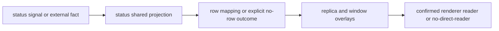

### path.usage

USD price first at ingress, then usage identity selection/index and cost ledger; finite nonnegative costUsd sums, unpriced metadata affects coverage but plain noncanonical tokens need not. Core unavailable omits USD; backend costOf returns undefined when no total, so cost_missing, NOT row cost_unavailable. Token/min and USD/min independent. Backend current epoch replaces cost; costRatePerMin *60=>burnPerHour. Swarm requires observed working priced cost; /60 and USD/min thresholds 0.05,0.15,0.4,1. Before prices, missing cost possible even for priceable adapters.

Semantic signals: usage/usage

Fields: field.cost, field.cost.usd, field.cost.coverage, field.cost.burnPerHour, field.cost.series, field.cost.series.stepMs, field.cost.series.steps, field.cost.series.lastStepAt, field.tokens, field.tokens.total, field.tokens.perMinute

Candidate states: state.cost_complete, state.cost_partial, state.cost_missing, state.burn_flames_0, state.burn_flames_1, state.burn_flames_2, state.burn_flames_3, state.burn_flames_4, state.burn_unpriced

puppeteer:packages/runtime/src/services/usage-pricing.ts:19-78; puppeteer:packages/core/src/monitor/usage-index.ts:210-223; puppeteer:packages/core/src/monitor/usage-index.ts:321-330; puppeteer:packages/core/src/monitor/usage-index.ts:453-550; puppeteer:packages/core/src/monitor/cost.ts:21-101; puppeteer:packages/core/src/monitor/project.ts:347-351; puppeteer:packages/core/src/monitor/project.ts:417; puppeteer:packages/monitor/src/backend/usage-ledger.ts:62-118; puppeteer:packages/monitor/src/backend/backend.ts:190-207; puppeteer:packages/monitor/src/backend/backend.ts:404-435; puppeteer:packages/monitor/src/backend/derive.ts:198-207; puppeteer:packages/views/src/views/swarm/bubble-model.ts:469-477; puppeteer:packages/views/src/views/swarm/bubble-model.ts:60-66


### path.context

Root claims only; provider percentage > derived > unavailable, then entry preference. Explicit usedPercentage wins else usedTokens/capacity*100 clamped [0,100], positive capacity required. No selected percentage => row context omitted. No token-usage-to-context inference. Hot is Swarm floor(usedPercent)>=80.

Semantic signals: context/context

Fields: field.context, field.context.usedPercent

Candidate states: state.context_missing, state.context_hot

puppeteer:packages/core/src/monitor/project.ts:90-117; puppeteer:packages/monitor/src/backend/derive.ts:247; puppeteer:packages/monitor/src/backend/derive.ts:274


### path.model

Root observed intent preferred to configured, each selected by entry preference; row displayName || id. Null event retracts only the actor+intent key (may expose fallback configured value). intent/configured/asOf not carried to row.

Semantic signals: model/model

Fields: field.model

Candidate states: state.model_missing

puppeteer:packages/core/src/monitor/reduce.ts:771-783; puppeteer:packages/core/src/monitor/project.ts:119-140; puppeteer:packages/monitor/src/backend/derive.ts:244; puppeteer:packages/monitor/src/backend/derive.ts:271

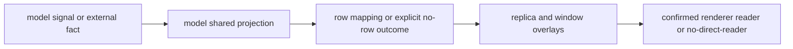

### path.effort

Root observed preferred to configured; row copies value and intent only. Null event retracts same actor+intent claim, may reveal configured value. No fixed effort-name enum.

Semantic signals: effort/effort

Fields: field.effort, field.effort.value, field.effort.intent

Candidate states: state.effort_configured, state.effort_observed, state.effort_absent

puppeteer:packages/core/src/monitor/reduce.ts:786-797; puppeteer:packages/core/src/monitor/project.ts:142-155; puppeteer:packages/monitor/src/backend/derive.ts:176-181

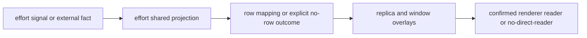

### path.mode

Provider session/permission mode keeps observed (or legacy missing intent) over configured; modes.execution comes from accumulator.executionMode updated by runtime metadata, NOT mode event value.executionMode. No MonitorAgentRow/AgentView mode field or builtin view reader; accepted batch may still refresh evidence recency.

Semantic signals: mode/mode

Fields: no direct row property; see field inventory

Candidate states: none directly

puppeteer:packages/core/src/monitor/reduce.ts:800-813; puppeteer:packages/core/src/monitor/project.ts:157-179; puppeteer:packages/core/src/monitor/project.ts:421-429; puppeteer:packages/runtime/src/services/monitor-service.ts:204-224; puppeteer:packages/monitor/src/backend/derive.ts:252-286

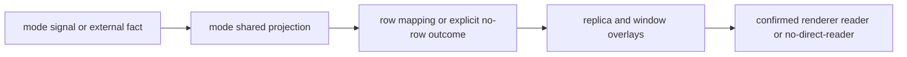

### path.conversation

Latest root message by effective/observed time and preference; children excluded from root reply. Event text trimmed, bounded by core max (400 plus ellipsis); blank does not overwrite prior reply. Semantic message schema max4096; row trims and host replyMaxLength-bounds. Event final=false opens responding, otherwise closes it; a semantic message by itself does not create responding activity. turn:completed may supply final reply. messageId/asOf details not all forwarded.

Semantic signals: conversation/message

Fields: field.reply, field.reply.text, field.reply.at, field.reply.final, field.activity, field.activity.kind, field.activity.line, field.activity.since, field.status

Candidate states: state.reply_streaming, state.reply_final, state.reply_missing, state.activity_responding, state.idle, state.working

puppeteer:packages/core/src/monitor/reduce.ts:742-746; puppeteer:packages/core/src/monitor/reduce.ts:877-938; puppeteer:packages/core/src/monitor/project.ts:77-88; puppeteer:packages/core/src/events/monitor.ts:138-144; puppeteer:packages/monitor/src/backend/derive.ts:189-196

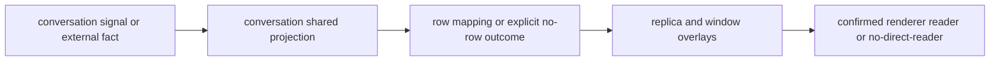

### path.delegation

Proven child actor requires role child and nativeAgentId. Active child state fallback produces delegating; stopped or blocked children not runnable; idle/unknown child state closes older work by evidence time. Count/subagent metrics in core have no direct row field; child activity and blockers affect root status/wait.

Semantic signals: delegation/actor

Fields: field.status, field.activity, field.activity.kind, field.activity.line, field.activity.since, field.wait, field.wait.kind, field.wait.since, field.wait.count, field.wait.tool, field.wait.code, field.wait.header, field.wait.question, field.wait.detail

Candidate states: state.working, state.idle, state.blocked, state.activity_delegating, state.working_with_blockers

puppeteer:packages/core/src/monitor/transitions.ts:291-338; puppeteer:packages/core/src/monitor/transitions.ts:361-371; puppeteer:packages/core/src/monitor/project.ts:202-245; puppeteer:packages/core/src/monitor/project.ts:358-367

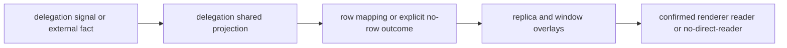

### path.compaction

Active root compaction ranks above tool. Child compaction feeds runnable child delegation, not root compacting. Completed clears active compaction for matching key. Active/outcome/count core fields not row fields; global compaction can retain observations. No automatic context reset in shared reducer.

Semantic signals: compaction/compaction

Fields: field.activity, field.activity.kind, field.activity.line, field.activity.since, field.detail, field.status

Candidate states: state.activity_compacting, state.working, state.idle, state.blocked

puppeteer:packages/core/src/monitor/reduce.ts:281-292; puppeteer:packages/core/src/monitor/transitions.ts:212-259; puppeteer:packages/core/src/monitor/transitions.ts:372-409

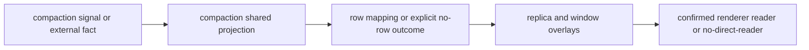

### path.environment

Partial upsert merges cwd/git/worktrees; changed cwd with omitted git deletes old same-entry git. Select one root logical environment claim (workspace authority can mask runtime/semantic git), then fold selected environments. project.name basename(observed cwd || host paths) fallback provider label/id. branch nonempty observed > host fallback > explicit observed git answer including null > host workspace branch. Project identity assigns seq, replica maps seq to colour; peer strips seq. No branch_none if no selected git and host workspace does not supply null.

Semantic signals: environment/environment

Fields: field.project, field.project.name, field.project.branch, field.project.seq, field.colour

Candidate states: state.branch_unknown, state.branch_named, state.branch_none

puppeteer:packages/core/src/monitor/reduce.ts:100-117; puppeteer:packages/core/src/monitor/selection.ts:22-26; puppeteer:packages/core/src/monitor/selection.ts:119-120; puppeteer:packages/core/src/monitor/transitions.ts:343-358; puppeteer:packages/core/src/monitor/project.ts:248-257; puppeteer:packages/monitor/src/backend/derive.ts:91-112; puppeteer:packages/monitor/src/backend/backend.ts:400-403; puppeteer:packages/monitor/src/replica/replica.ts:245-255

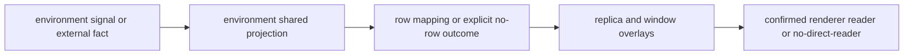

### path.freshness

All accepted evidence advances lastEvidenceAt (workspace provenance excluded); families support/availability independent of row stale. Unsupported family does not forbid actual evidence projection. Row stale false without state/idle/root tool; else clock >30s. Peer window overrides from board standing. Events translated to no updates do not advance clock.

Semantic signals: not adapter-owned

Fields: field.stale

Candidate states: state.stale, state.fresh

puppeteer:packages/core/src/monitor/project.ts:259-316; puppeteer:packages/core/src/monitor/project.ts:338-343; puppeteer:packages/core/src/monitor/project.ts:379-395; puppeteer:packages/monitor/src/backend/derive.ts:215-224; vibefield:packages/field-app/src/godview/monitor/window-rows.ts:116-136

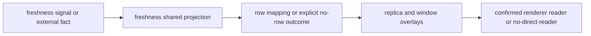

### path.host

Host metadata, row identity, provider/account/profile/device/tier/pending/attachable are not adapter signals. source can exist with no adapter monitor. Agent row inputUsed absent; bare-terminal path separately classified.

Semantic signals: not adapter-owned

Fields: no direct row property; see field inventory

Candidate states: state.starting_unobserved, state.pending_unobserved, state.attachable, state.tier_managed, state.tier_ingested, state.tier_remote, state.remote

puppeteer:packages/monitor/src/backend/derive.ts:26-113; puppeteer:packages/monitor/src/backend/derive.ts:183-186; puppeteer:packages/monitor/src/backend/derive.ts:240-320; vibefield:packages/fieldd/src/agent-monitor.ts:225-285

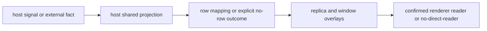

### path.window

Window local facts activeIds/receded callback/attachments/spawnHints, colour and visual continuity; peer standing stale override. These predicates are not adapters and can change with no new evidence.

Semantic signals: not adapter-owned

Fields: no direct row property; see field inventory

Candidate states: state.active, state.receded, state.attached, state.detached, state.remote

puppeteer:packages/monitor/src/replica/replica.ts:245-373; vibefield:packages/field-app/src/godview/monitor/window-rows.ts:99-151

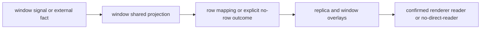

### path.history

Independent host history port over index.activity/rosettad, NOT an adapter event or row field. Join provider+native session; derivePast worked/quiet/unrecorded; bounds only ended lane if no usable turn detail (live row skipped). Timeline stateAt before birth unborn, ended at/after end, before since historical/unrecorded, otherwise current span. Historical service occurrence remains conditional on stored record; no live history sample taken.

Semantic signals: not adapter-owned

Fields: no direct row property; see field inventory

Candidate states: state.past_worked, state.past_quiet, state.past_unrecorded, state.past_bounds, state.timeline_unborn, state.timeline_unrecorded, state.timeline_past, state.timeline_ended, state.timeline_span, state.spend_before, state.spend_unknown

vibefield:packages/fieldd/src/index-activity.ts:17-36; vibefield:packages/fieldd/src/index-activity.ts:225-280; puppeteer:packages/monitor/src/backend/past.ts:120-144; puppeteer:packages/monitor/src/backend/past.ts:156-242; puppeteer:packages/views/src/views/timeline/timeline-lanes.ts:239-252

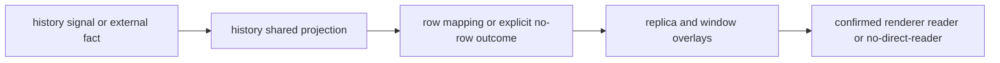

## Row-field join table

All file:line citations, per-field detailed rules/defaults and per-view consumer citations are retained in JSON (fields[].source, fields[].rendererConsumers). No-direct-reader is scoped to five production views/toolkit, excluding labs/tests; absence does not mean no indirect UI effect.

| field ID | continuation | default | direct view IDs | overlay/indirect |
|---|---|---|---|---|
| field.inputUsed | path.host | absent | no direct reader | unchanged spread (row itself may be suppressed/reordered); window membership / visual continuity / peer standing |
| field.creationId | path.host | absent | no direct reader | unchanged spread (row itself may be suppressed/reordered); window membership / visual continuity / peer standing |
| field.id | path.host | required; assigned by backend | view.list, view.rain, view.swarm, view.spend, view.timeline | unchanged spread (row itself may be suppressed/reordered) |
| field.kind | path.host | agent or terminal by source | view.list, view.rain, view.swarm, view.spend, view.timeline | unchanged spread (row itself may be suppressed/reordered) |
| field.createdAt | path.host | 0 when host does not know | view.spend, view.timeline | unchanged spread (row itself may be suppressed/reordered) |
| field.status | path.status | working before first agent state; idle for pending/bare quiet terminal | view.list, view.rain, view.swarm, view.spend, view.timeline | unchanged spread (row itself may be suppressed/reordered) |
| field.statusSince | path.status | host.createdAt for agent without valid clock | view.spend, view.timeline | unchanged spread (row itself may be suppressed/reordered) |
| field.stale | path.freshness | false for terminal | view.list, view.swarm | stale overwritten for peers |
| field.alive | path.status | true absent runtime/host exit | no direct reader | unchanged spread (row itself may be suppressed/reordered); replica/host visibility, not builtin view business reader |
| field.observed | path.host | false before first state or pending | view.list, view.rain, view.swarm, view.spend | unchanged spread (row itself may be suppressed/reordered) |
| field.pending | path.host | absent; not false | view.list, view.rain, view.swarm, view.spend | unchanged spread (row itself may be suppressed/reordered) |
| field.detail | path.status | starting for new agent; Unassigned terminal for terminal without cwd | view.list, view.rain, view.swarm, view.spend | unchanged spread (row itself may be suppressed/reordered) |
| field.activity | path.status | absent without evidence | view.swarm | unchanged spread (row itself may be suppressed/reordered) |
| field.activity.kind | path.status | No independent default; inherits activity derivation (optional means omitted, not null). | view.swarm | unchanged spread (row itself may be suppressed/reordered) |
| field.activity.line | path.status | No independent default; inherits activity derivation (optional means omitted, not null). | no direct reader | unchanged spread (row itself may be suppressed/reordered) |
| field.activity.since | path.status | No independent default; inherits activity derivation (optional means omitted, not null). | no direct reader | unchanged spread (row itself may be suppressed/reordered) |
| field.project | path.environment | required object; branch/seq absent if unknown | view.list, view.rain, view.swarm, view.spend, view.timeline | unchanged spread (row itself may be suppressed/reordered) |
| field.project.name | path.environment | No independent default; inherits project derivation (optional means omitted, not null). | view.list, view.rain, view.swarm, view.spend, view.timeline | unchanged spread (row itself may be suppressed/reordered) |
| field.project.branch | path.environment | absent = not observed/no fallback; null = looked and no repository/branch; nonempty runtime branch > host fallback > observed null > workspace branch | view.list, view.rain, view.swarm, view.spend, view.timeline | unchanged spread (row itself may be suppressed/reordered) |
| field.project.seq | path.environment | No independent default; inherits project derivation (optional means omitted, not null). | no direct reader | unchanged spread (row itself may be suppressed/reordered); field.colour => builtin view colour readers |
| field.provider | path.host | absent for bare terminal | view.list, view.rain, view.swarm, view.spend, view.timeline | unchanged spread (row itself may be suppressed/reordered) |
| field.provider.id | path.host | No independent default; inherits provider derivation (optional means omitted, not null). | view.list, view.swarm, view.spend | unchanged spread (row itself may be suppressed/reordered) |
| field.provider.label | path.host | No independent default; inherits provider derivation (optional means omitted, not null). | view.list, view.rain, view.swarm, view.spend, view.timeline | unchanged spread (row itself may be suppressed/reordered) |
| field.model | path.model | absent without runtime model | view.list, view.rain, view.swarm, view.spend, view.timeline | unchanged spread (row itself may be suppressed/reordered) |
| field.effort | path.effort | absent without runtime effort; toolkit treats omitted intent as observed | view.swarm | unchanged spread (row itself may be suppressed/reordered) |
| field.effort.value | path.effort | No independent default; inherits effort derivation (optional means omitted, not null). | view.swarm | unchanged spread (row itself may be suppressed/reordered) |
| field.effort.intent | path.effort | absent treated as observed by swarm renderer, not rewritten on model | view.swarm | unchanged spread (row itself may be suppressed/reordered) |
| field.account | path.host | absent | view.list | unchanged spread (row itself may be suppressed/reordered) |
| field.context | path.context | absent for missing/nonfinite percent | view.list, view.rain, view.swarm | unchanged spread (row itself may be suppressed/reordered) |
| field.context.usedPercent | path.context | No independent default; inherits context derivation (optional means omitted, not null). | view.list, view.rain, view.swarm | unchanged spread (row itself may be suppressed/reordered) |
| field.wait | path.status | absent without blockers; count absent means 1 | view.list, view.rain, view.swarm, view.spend, view.timeline | unchanged spread (row itself may be suppressed/reordered) |
| field.wait.kind | path.status | No independent default; inherits wait derivation (optional means omitted, not null). | view.list, view.rain, view.swarm, view.spend, view.timeline | unchanged spread (row itself may be suppressed/reordered) |
| field.wait.since | path.status | No independent default; inherits wait derivation (optional means omitted, not null). | no direct reader | unchanged spread (row itself may be suppressed/reordered) |
| field.wait.count | path.status | omitted when exactly one; includes core omitted.blockers when >1 | no direct reader | unchanged spread (row itself may be suppressed/reordered) |
| field.wait.tool | path.status | No independent default; inherits wait derivation (optional means omitted, not null). | view.list, view.rain, view.swarm, view.spend | unchanged spread (row itself may be suppressed/reordered) |
| field.wait.code | path.status | No independent default; inherits wait derivation (optional means omitted, not null). | view.swarm | unchanged spread (row itself may be suppressed/reordered) |
| field.wait.header | path.status | No independent default; inherits wait derivation (optional means omitted, not null). | view.swarm | unchanged spread (row itself may be suppressed/reordered) |
| field.wait.question | path.status | No independent default; inherits wait derivation (optional means omitted, not null). | view.list, view.rain, view.swarm, view.spend, view.timeline | unchanged spread (row itself may be suppressed/reordered) |
| field.wait.detail | path.status | No independent default; inherits wait derivation (optional means omitted, not null). | view.swarm, view.spend, view.timeline | unchanged spread (row itself may be suppressed/reordered) |
| field.reply | path.conversation | absent without nonblank message | view.list, view.rain, view.swarm, view.spend | unchanged spread (row itself may be suppressed/reordered) |
| field.reply.text | path.conversation | No independent default; inherits reply derivation (optional means omitted, not null). | view.list, view.rain, view.swarm, view.spend | unchanged spread (row itself may be suppressed/reordered) |
| field.reply.at | path.conversation | No independent default; inherits reply derivation (optional means omitted, not null). | no direct reader | unchanged spread (row itself may be suppressed/reordered) |
| field.reply.final | path.conversation | No independent default; inherits reply derivation (optional means omitted, not null). | no direct reader | unchanged spread (row itself may be suppressed/reordered) |
| field.cost | path.usage | absent without ledger.total; rate optional; emitted cost includes series | view.swarm, view.spend | unchanged spread (row itself may be suppressed/reordered) |
| field.cost.usd | path.usage | No independent default; inherits cost derivation (optional means omitted, not null). | view.swarm, view.spend | unchanged spread (row itself may be suppressed/reordered) |
| field.cost.coverage | path.usage | No independent default; inherits cost derivation (optional means omitted, not null). | view.swarm, view.spend | unchanged spread (row itself may be suppressed/reordered) |
| field.cost.burnPerHour | path.usage | No independent default; inherits cost derivation (optional means omitted, not null). | view.swarm | unchanged spread (row itself may be suppressed/reordered) |
| field.cost.series | path.usage | No independent default; inherits cost derivation (optional means omitted, not null). | view.spend | unchanged spread (row itself may be suppressed/reordered) |
| field.cost.series.stepMs | path.usage | No independent default; inherits cost derivation (optional means omitted, not null). | view.spend | unchanged spread (row itself may be suppressed/reordered) |
| field.cost.series.steps | path.usage | No independent default; inherits cost derivation (optional means omitted, not null). | view.spend | unchanged spread (row itself may be suppressed/reordered) |
| field.cost.series.lastStepAt | path.usage | No independent default; inherits cost derivation (optional means omitted, not null). | view.spend | unchanged spread (row itself may be suppressed/reordered) |
| field.tokens | path.usage | absent if neither metric | no direct reader | unchanged spread (row itself may be suppressed/reordered) |
| field.tokens.total | path.usage | No independent default; inherits tokens derivation (optional means omitted, not null). | no direct reader | unchanged spread (row itself may be suppressed/reordered) |
| field.tokens.perMinute | path.usage | No independent default; inherits tokens derivation (optional means omitted, not null). | no direct reader | unchanged spread (row itself may be suppressed/reordered) |
| field.unread | path.status | false for first sight, terminals, shown/nonidle rows | view.swarm, view.spend, view.timeline | unchanged spread (row itself may be suppressed/reordered) |
| field.device | path.host | required id/name/self; os absent when unknown | view.list, view.rain, view.swarm, view.spend, view.timeline | unchanged spread (row itself may be suppressed/reordered) |
| field.device.id | path.host | No independent default; inherits device derivation (optional means omitted, not null). | view.swarm | unchanged spread (row itself may be suppressed/reordered); window membership / visual continuity / peer standing |
| field.device.name | path.host | No independent default; inherits device derivation (optional means omitted, not null). | view.list, view.rain, view.swarm, view.spend, view.timeline | unchanged spread (row itself may be suppressed/reordered) |
| field.device.os | path.host | No independent default; inherits device derivation (optional means omitted, not null). | no direct reader | unchanged spread (row itself may be suppressed/reordered) |
| field.device.self | path.host | No independent default; inherits device derivation (optional means omitted, not null). | view.list, view.rain, view.swarm, view.spend, view.timeline | unchanged spread (row itself may be suppressed/reordered) |
| field.tier | path.host | absent if no tier | no direct reader | unchanged spread (row itself may be suppressed/reordered) |
| field.profileSet | path.host | native for agent without mapping; terminal optional | view.swarm | profileSet omitted for peers |
| field.attachable | path.host | false absent agent terminal id | no direct reader | unchanged spread (row itself may be suppressed/reordered) |
| field.writable | path.host | wire absence -> attachable | no direct reader | unchanged spread (row itself may be suppressed/reordered) |
| field.colour | path.window | currentColor | view.list, view.rain, view.swarm, view.spend, view.timeline | unchanged spread (row itself may be suppressed/reordered) |
| field.active | path.window | false | view.list, view.rain, view.swarm, view.spend, view.timeline | unchanged spread (row itself may be suppressed/reordered) |
| field.receded | path.window | false with no predicate | view.list, view.rain, view.swarm, view.timeline | unchanged spread (row itself may be suppressed/reordered) |
| field.attachment | path.window | absent | view.list, view.rain, view.swarm, view.spend, view.timeline | unchanged spread (row itself may be suppressed/reordered) |
| field.attachment.panes | path.window | No independent default; inherits attachment derivation (optional means omitted, not null). | view.rain | unchanged spread (row itself may be suppressed/reordered) |
| field.attachment.colour | path.window | No independent default; inherits attachment derivation (optional means omitted, not null). | view.rain, view.swarm | unchanged spread (row itself may be suppressed/reordered) |
| field.spawnHint | path.window | absent | view.swarm | unchanged spread (row itself may be suppressed/reordered) |
| field.spawnHint.x | path.window | No independent default; inherits spawnHint derivation (optional means omitted, not null). | view.swarm | unchanged spread (row itself may be suppressed/reordered) |
| field.spawnHint.y | path.window | No independent default; inherits spawnHint derivation (optional means omitted, not null). | view.swarm | unchanged spread (row itself may be suppressed/reordered) |
| field.visualId | path.window | absent -> id in spatial view | view.swarm | visual continuity recalculated |

## Important non-equivalences

- Context occupancy is not usage or USD. A valid token/capacity pair can derive context percentage without a raw usedPercentage.
- Raw absence of costUsd is not cost impossibility: Codex pricing is consumed before reduction; Claude has provider USD or catalog fallback. Only these two have traced current native price producers.
- Core costCoverage unavailable is not row cost.coverage unavailable: normal backend omits the entire cost object until a priced total exists.
- Token/min does not drive priced flames; flames are USD/min at inclusive 0.05/0.15/0.4/1 thresholds on observed working bodies.
- Row state reply_streaming is representable and carries reply.final=false even though no builtin production view directly reads that final flag.
- Explicit selected git.branch=null can produce branch_none. Five GV4 adapters do not supply it, but Copilot normalization can; workspace environment claim authority can mask that git. No global unreachable claim is made.
- A mode update has a real core state path but no row mode field; accepted evidence may still move freshness.
- History/timeline, spawn/feed/device standing, terminals, active/receded/attachments and pending states are separate host/window sources, not adapter event types.

## Cross-check against GV-AUDIT4

Read 370 records at 29f77e99291d0b2743b58a88e15e49decce048e6. No conflicting final producer verdict found on this shared-only review. Three actionable issues/qualifications:

### comparison.cost-pricing-hop (material-omission)

Cost records trace acceptSemantic -> selectClaims -> project -> derive but omit runtime priceUsageUpdates before reduction. Current five still have no price producer; their negative priced-state conclusion is compatible. Do not generalize the absence-of-direct-costUsd reasoning to Codex/Claude.

Affected records: 40

puppeteer:packages/runtime/src/services/monitor-service.ts:418-425; puppeteer:packages/runtime/src/services/usage-pricing.ts:19-78

### comparison.cost-transform-order (incorrect-causal-order)

transforms places deriveAgentRow before buildUsageCostLedger/costOf. Real execution prices at ingress, reduces, projects cost, observes backend usage ledger, obtains costOf input, then derives row.

Affected records: 40

puppeteer:packages/core/src/monitor/project.ts:347-351; puppeteer:packages/monitor/src/backend/backend.ts:404-442

### comparison.core-unavailable-vs-row (stale-pending-language)

Summary leaves state.cost_unavailable not ruled out for token-only producers. Shared path settles this: absent USD => no row cost => cost_missing; present coverage unavailable is not emitted by normal backend. This corrects an unresolved possibility, not a contradictory final verdict.

Affected records: 1

puppeteer:packages/monitor/src/backend/backend.ts:190-207; puppeteer:packages/monitor/src/backend/derive.ts:277

Renderer-set differences (not automatically contradictions): 0

```json
[]
```

## Remaining limits

The original adapter raw traces are retained without asserting live observations. State predicates and their shared continuations are joined; adapter-specific existence proofs for every non-cost combination are still the producer audit’s responsibility. External history data and the installed 0.3.3 code are not tested here. No commits, source edits or pushes were made.
