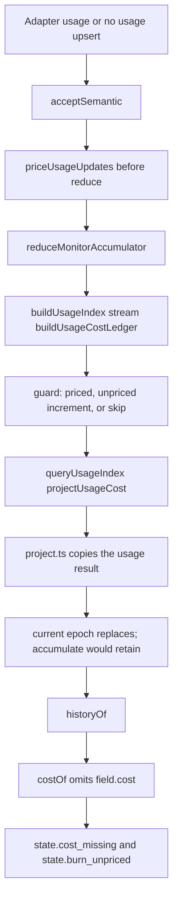

# GV-AUDIT4 evidence summary

Pins: vibefield `433505fd0f224f4cda540d642661b13848c0ef82`, puppeteer `748d015a7e393112e0a91dad80111fdf5abe6583`.

This source is newer than the puppeteer 0.3.3 package vibefield ships (tag `v0.3.3`, commit `52d09c8e84951b9a355a6700eac2dfc1290a9fa0`). The audit does not compare 0.3.3 behavior. The provenance schema has no `sourceVersion` property, so a transform whose puppeteer path differs from `52d09c8e` ends its effect with `[post-0.3.3]`.

Traces: `audit/godview/evidence/<suffix>/<fieldPath>.json` for grok, hermes, kimi, opencode, and pi. `fieldPath` is the model field id without the `field.` prefix.

## Presence counts

| adapter | present | absent | unsupported | unknown |
| --- | --- | --- | --- | --- |
| adapter.grok | 62 | 12 | 0 | 0 |
| adapter.hermes | 64 | 10 | 0 | 0 |
| adapter.kimi | 59 | 12 | 3 | 0 |
| adapter.opencode | 64 | 10 | 0 | 0 |
| adapter.pi | 55 | 12 | 7 | 0 |

## Mismatches

None.

## History and timeline

Same path for all five. None of these adapters emit past spans. The record is fieldd's history port over rosettad (`packages/fieldd/src/index-activity.ts:17-36` and `230-280`), joined by provider id plus native session id. grok, hermes, kimi, opencode, and pi are catalog ids (`packages/contracts/src/agent-catalog.ts`). `derivePast` (`packages/monitor/src/backend/past.ts:204-242`) turns that record into spans. The timeline reads them in `stateAt` (`packages/views/src/views/timeline/timeline-lanes.ts:247-252`). This slice did not execute a live rosettad session.

- `state.past_worked`, `state.past_quiet`, `state.past_unrecorded`: reachable when `index.activity` answers `fidelity: "turns"` and the session has turns. `spansFromTurns` (`past.ts:120-144`) marks the inside of a turn worked, a silence longer than `PAST_SILENCE_MS` (15 minutes, `past.ts:39`) unrecorded, and the gap between turns quiet.
- `state.past_bounds`: reachable on an ended lane when fidelity is `bounds`, or when a session's turns were not read (`past.ts:166-170`). A live row is skipped in that case (`past.ts:226-227`), so bounds is not that live row's past.
- `state.timeline_unborn`: cursor before `lane.bornMs`.
- `state.timeline_unrecorded`: no joined past, or a span whose kind is unrecorded (`timeline-lanes.ts:240-251`).
- `state.timeline_past`: a worked, quiet, or bounds span covers the cursor.
- `state.timeline_ended`: an ended lane at or after `endedAt`.
- `state.timeline_span`: a live lane at or after `sinceMs`, which is the row's current status.

The runtime can produce these without the adapter emitting them. Whether a particular stored session already has turns is not re-checked here.

## state.branch_none

Unreachable on the full VibeField path for all five, not only because the adapter omits git.

`projectBranch` (`packages/monitor/src/backend/derive.ts:101-107`) returns null only when `environment.git` is defined and neither `git.branch` nor `host.fallbackBranch` is set. These adapters write cwd and never git. `recordWorkspaceEvidence` publishes cwd and worktrees with no git (`packages/runtime/src/runtime.ts:1325-1340`). Provenance git stays off the public environment (`packages/core/src/monitor/reduce.ts:625-631`). `hostRunFromSummary` copies `summary.workspace.branch` when present and does not set `fallbackBranch` (`packages/fieldd/src/agent-monitor.ts:248-256`; `packages/monitor/src/backend/ports.ts:53-58` says VibeField supplies none). A missing observation stays absent (`state.branch_unknown`) or becomes that host string (`state.branch_named`).

## Account and profileSet

Source: `audit/godview/contracts/account-trace.md` at `08b5d849177685662b43e0e3a4e6bd7d32ac2cdf` on `audit/godview-model`, checked against the pins.

`field.account` is not an adapter field. `deriveAgentRow` copies `host.account` only (`packages/monitor/src/backend/derive.ts:273`). The VibeField host `hostRunFromSummary` (`packages/fieldd/src/agent-monitor.ts:223-266`) copies `profileId` and `profileSet` and never `account`, so under this product the field is unreachable for grok, hermes, kimi, opencode, and pi. The Puppeteer Godview host is a different host: `monitorHostRun` (`apps/godview/src/main/monitor-host.ts:62,79`) fills `account` from the profile label for these five, because each has a profiles service. ACP is the exception and is outside this slice. `accountUsage` (grok at `providers.ts:671`, kimi at `providers.ts:751`; hermes, opencode, and pi have none) feeds the usage column (`packages/views/src/usage/account-usage.ts:63-82`), not `field.account`.

`field.profileSet` is always present on an agent row. `resolveProfileSet` (`derive.ts:62-66`), applied at `backend.ts:433`, takes the host value, then the set that lists `profileId`, then `native`. A run with no profile is native. `window-rows.ts:119-134` removes `profileSet` from rows whose device is not this one.

## Cost and burn

Corrected against puppeteer `68dde825266e63ba63a1b07f7fcfd1e85f868b1f` (the Claude cost graph) and re-read at vibefield `433505fd` and puppeteer `748d015`.

The ledger guard is `buildUsageCostLedger` (`packages/core/src/monitor/cost.ts:31-33`). A finite nonnegative `costUsd`, including 0, increments `priced` and adds to the total. A missing, invalid, or negative `costUsd` increments `unpriced` only when `canonical`, `pricing`, or `cost` is truthy. A sample with none of those is skipped. `projectUsageCost` (`cost.ts:96-97`) omits `costUsd` and `costRatePerMin` whenever `priced` is 0, and sets coverage `unavailable`. An unpriced increment does not make that coverage partial. Partial needs `priced > 0` as well.

Chronology: `accept` prices updates before `reduceMonitorAccumulator` (`monitor-service.ts:418-425`). `usageIndexOf` (`usage-index.ts:578-584`) calls `buildUsageIndex`, whose run stream (`usage-index.ts:427`) calls `buildUsageCostLedger` from `stream` (`usage-index.ts:210-223`). `queryUsageIndex` calls `projectUsageCost` later (`usage-index.ts:549`). `project.ts:346-351` runs that projection, and `project.ts:417` only then copies the usage result.

Epochs are separate. The backend default is `accumulate` when a host omits the option (`backend.ts:132`). Godview sets `acrossEpochs` `accumulate` (`apps/godview/src/main/main.ts:744`), so `backend.ts:410-425` can keep a prior epoch's `costUsd` when the current run has `priced` 0. VibeField sets `acrossEpochs` `current` (`packages/fieldd/src/agent-monitor.ts:478-480`), so a new epoch replaces that run. `historyOf` (`usage-ledger.ts:62-82`) leaves `history.total` absent unless a retained run has `costUsd`. `costOf` (`backend.ts:197-207`) then omits `field.cost`. `burnPerHour` is the current `costRatePerMin` times 60, and that rate is omitted when `priced` is 0.

Guard branch for these five, all of which have no price:

- grok: guarded increment. `usage.ts:41-55` is canonical and has no pricing, cost, or costUsd. `priceUsageUpdates` selects it (`usage-pricing.ts:75`) and `priceUsage` sets cost source unavailable with no costUsd (`usage-pricing.ts:27-28`). `cost.ts:31-33` increments `unpriced`. `priced` stays 0.
- opencode: the same guarded increment. `monitor.ts:136-153` is canonical and has no pricing, cost, or costUsd.
- hermes: skip. `monitor.ts:311-321` and `monitor.ts:699-711` are canonical false, with no pricing, cost, or costUsd. `priceUsageUpdates` does not call `priceUsage` (`usage-pricing.ts:72-76`). `cost.ts:31-33` does not increment `unpriced`. `priced` stays 0.
- kimi: neither arm. `monitor.ts:372-396` stores `usage.record` as context and emits no usage upsert, so the ledger loop does not run. `priced` and `unpriced` stay 0.
- pi: neither arm. The pipeline emits no `usage:tokens-used`, and `monitor.ts` publishes an empty update list. `priced` and `unpriced` stay 0.

No epoch has `costUsd`, so Godview's accumulate mode also retains nothing. Under VibeField the row omits `field.cost` (`state.cost_missing`). A working observed swarm body is `state.burn_unpriced` (`bubble-model.ts:469-523`). `state.cost_complete`, `state.cost_partial`, `state.cost_unavailable`, and `state.burn_flames_0` through `state.burn_flames_4` do not occur. `state.cost_unavailable` would be a present `field.cost` with coverage unavailable; `costOf` does not build that object when `history.total` is absent.

Disagreement with `68dde825`: its Claude graph places `reduce.ts:1049-1073` after `priceUsageUpdates` and says that range copies the already priced `costUsd`. At `748d015`, `acceptAgentEvent` (`monitor-service.ts:233-253`) calls `translateAgentEventEnvelope` first, and that case copies the event's own `costUsd` before `accept` prices the updates (`monitor-service.ts:418-425`). The store after pricing is `reduceMonitorAccumulator` (`reduce.ts:672-686`). grok, hermes, kimi, opencode, and pi do not go through the event case. Their usage, when they emit it, is already a semantic update.

## States

Adapter-silent means this adapter never emits the evidence, while the runtime, host, or window still can. Full-path means a run of this adapter still cannot reach the state after those other layers.

### adapter.grok

Reachable for a run of this adapter, including host and window layers:

- `state.active`
- `state.activity_compacting`
- `state.activity_delegating`
- `state.activity_other`
- `state.activity_reasoning`
- `state.activity_responding`
- `state.activity_tool`
- `state.attachable`
- `state.attached`
- `state.blocked`
- `state.blocked_failure`
- `state.blocked_permission`
- `state.blocked_question`
- `state.branch_named`
- `state.branch_unknown`
- `state.burn_unpriced`
- `state.context_hot`
- `state.context_missing`
- `state.cost_missing`
- `state.dead_hidden`
- `state.detached`
- `state.effort_absent`
- `state.effort_observed`
- `state.failed_retained`
- `state.fresh`
- `state.idle`
- `state.model_missing`
- `state.past_bounds`
- `state.past_quiet`
- `state.past_unrecorded`
- `state.past_worked`
- `state.pending_unobserved`
- `state.receded`
- `state.remote`
- `state.reply_final`
- `state.reply_missing`
- `state.reply_streaming`
- `state.spend_before`
- `state.spend_unknown`
- `state.stale`
- `state.starting_unobserved`
- `state.tier_ingested`
- `state.tier_managed`
- `state.tier_remote`
- `state.timeline_ended`
- `state.timeline_past`
- `state.timeline_span`
- `state.timeline_unborn`
- `state.timeline_unrecorded`
- `state.unread`
- `state.wait_multiple`
- `state.working`
- `state.working_with_blockers`

Adapter does not emit it; the runtime, host, or window still can:

- `state.feed_no_door` — Feed door state in model-replica, not an adapter row and not window-rows.
- `state.feed_connecting` — Feed door state in model-replica, not an adapter row and not window-rows.
- `state.feed_live` — Feed door state in model-replica, not an adapter row and not window-rows.
- `state.feed_unavailable` — Feed door state in model-replica, not an adapter row and not window-rows.
- `state.spawn_ready` — Spawn menu device state, not this adapter and not window-rows.
- `state.spawn_asleep` — Spawn menu device state, not this adapter and not window-rows.
- `state.spawn_silent` — Spawn menu device state, not this adapter and not window-rows.
- `state.spawn_incompatible` — Spawn menu device state, not this adapter and not window-rows.
- `state.spawn_reading` — Spawn menu device state, not this adapter and not window-rows.
- `state.device_live` — Board standing. window-rows only reads it to override a peer's field.stale.
- `state.device_stale` — Board standing. window-rows only reads it to override a peer's field.stale.
- `state.device_asleep` — Board standing. window-rows only reads it to override a peer's field.stale.
- `state.device_incompatible` — Board standing. window-rows only reads it to override a peer's field.stale.
- `state.terminal_running` — Bare terminal row. deriveAgentRow always sets kind agent. window-rows does not retarget these adapters into terminals.
- `state.terminal_quiet` — Bare terminal row. Same split as terminal_running.
- `state.terminal_empty` — Swarm presentation of a quiet terminal with nothing opening. Not this agent row.
- `state.terminal_opening` — Swarm opening overlay. Not a field these adapters set.
- `state.activity_starting` — Runtime initial run is lifecycle allocated (reduce.ts initialRunEntry, 298-312), which projectActivity renders as starting. The adapter does not emit it.

Full path for a run of this adapter cannot produce it:

- `state.blocked_unknown_kind` — core blockers are only permission, question, and failure (`packages/core/src/monitor/transitions.ts:93-170`).
- `state.branch_none` — see the branch section. The runtime type allows a null git answer; this host path never writes one.
- `state.cost_complete`, `state.cost_partial`, `state.cost_unavailable` — full path. grok takes the guarded increment. usage.ts:41-55 sets canonical true and sets no pricing, cost, or costUsd. priceUsageUpdates selects that upsert because canonical is true (usage-pricing.ts:75). priceUsage finds no pricing metadata and sets cost to source unavailable without costUsd (usage-pricing.ts:27-28). cost.ts:31-33 then increments unpriced, because canonical and the unavailable cost are both truthy. It does not take the skip branch. priced stays 0, so coverage is unavailable rather than partial. priced stays 0, so projectUsageCost omits costUsd. VibeField acrossEpochs current replaces the run, and no epoch has costUsd for Godview accumulate to retain. costOf omits field.cost. state.cost_unavailable is not a present cost object on this path.
- `state.burn_flames_0`, `state.burn_flames_1`, `state.burn_flames_2`, `state.burn_flames_3`, `state.burn_flames_4` — full path. Those flames need coverage complete or partial (bubble-model.ts:476-477). These rows omit cost, so a working body is state.burn_unpriced.
- `state.effort_configured` — this adapter never emits the evidence, and no host or window-rows path invents it.

### adapter.hermes

Reachable for a run of this adapter, including host and window layers:

- `state.active`
- `state.activity_compacting`
- `state.activity_delegating`
- `state.activity_other`
- `state.activity_responding`
- `state.activity_tool`
- `state.attachable`
- `state.attached`
- `state.blocked`
- `state.blocked_failure`
- `state.blocked_permission`
- `state.blocked_question`
- `state.branch_named`
- `state.branch_unknown`
- `state.burn_unpriced`
- `state.context_hot`
- `state.context_missing`
- `state.cost_missing`
- `state.dead_hidden`
- `state.detached`
- `state.effort_absent`
- `state.effort_configured`
- `state.effort_observed`
- `state.failed_retained`
- `state.fresh`
- `state.idle`
- `state.model_missing`
- `state.past_bounds`
- `state.past_quiet`
- `state.past_unrecorded`
- `state.past_worked`
- `state.pending_unobserved`
- `state.receded`
- `state.remote`
- `state.reply_final`
- `state.reply_missing`
- `state.reply_streaming`
- `state.spend_before`
- `state.spend_unknown`
- `state.stale`
- `state.starting_unobserved`
- `state.tier_ingested`
- `state.tier_managed`
- `state.tier_remote`
- `state.timeline_ended`
- `state.timeline_past`
- `state.timeline_span`
- `state.timeline_unborn`
- `state.timeline_unrecorded`
- `state.unread`
- `state.wait_multiple`
- `state.working`
- `state.working_with_blockers`

Adapter does not emit it; the runtime, host, or window still can:

- `state.feed_no_door` — Feed door state in model-replica, not an adapter row and not window-rows.
- `state.feed_connecting` — Feed door state in model-replica, not an adapter row and not window-rows.
- `state.feed_live` — Feed door state in model-replica, not an adapter row and not window-rows.
- `state.feed_unavailable` — Feed door state in model-replica, not an adapter row and not window-rows.
- `state.spawn_ready` — Spawn menu device state, not this adapter and not window-rows.
- `state.spawn_asleep` — Spawn menu device state, not this adapter and not window-rows.
- `state.spawn_silent` — Spawn menu device state, not this adapter and not window-rows.
- `state.spawn_incompatible` — Spawn menu device state, not this adapter and not window-rows.
- `state.spawn_reading` — Spawn menu device state, not this adapter and not window-rows.
- `state.device_live` — Board standing. window-rows only reads it to override a peer's field.stale.
- `state.device_stale` — Board standing. window-rows only reads it to override a peer's field.stale.
- `state.device_asleep` — Board standing. window-rows only reads it to override a peer's field.stale.
- `state.device_incompatible` — Board standing. window-rows only reads it to override a peer's field.stale.
- `state.terminal_running` — Bare terminal row. deriveAgentRow always sets kind agent. window-rows does not retarget these adapters into terminals.
- `state.terminal_quiet` — Bare terminal row. Same split as terminal_running.
- `state.terminal_empty` — Swarm presentation of a quiet terminal with nothing opening. Not this agent row.
- `state.terminal_opening` — Swarm opening overlay. Not a field these adapters set.
- `state.activity_starting` — Runtime initial run is lifecycle allocated (reduce.ts initialRunEntry, 298-312), which projectActivity renders as starting. The adapter does not emit it.

Full path for a run of this adapter cannot produce it:

- `state.blocked_unknown_kind` — core blockers are only permission, question, and failure (`packages/core/src/monitor/transitions.ts:93-170`).
- `state.branch_none` — see the branch section. The runtime type allows a null git answer; this host path never writes one.
- `state.cost_complete`, `state.cost_partial`, `state.cost_unavailable` — full path. hermes takes the skip branch. monitor.ts:311-321 and monitor.ts:699-711 emit usage samples with canonical false and no pricing, cost, or costUsd. priceUsageUpdates does not call priceUsage (usage-pricing.ts:72-76), so cost stays unset. cost.ts:31-33 sees a missing costUsd and none of canonical, pricing, or cost, and does not increment unpriced. priced stays 0. priced stays 0, so projectUsageCost omits costUsd. VibeField acrossEpochs current replaces the run, and no epoch has costUsd for Godview accumulate to retain. costOf omits field.cost. state.cost_unavailable is not a present cost object on this path.
- `state.burn_flames_0`, `state.burn_flames_1`, `state.burn_flames_2`, `state.burn_flames_3`, `state.burn_flames_4` — full path. Those flames need coverage complete or partial (bubble-model.ts:476-477). These rows omit cost, so a working body is state.burn_unpriced.
- `state.activity_reasoning` — this adapter never emits the evidence, and no host or window-rows path invents it.

### adapter.kimi

Reachable for a run of this adapter, including host and window layers:

- `state.active`
- `state.activity_compacting`
- `state.activity_delegating`
- `state.activity_other`
- `state.activity_reasoning`
- `state.activity_responding`
- `state.activity_tool`
- `state.attachable`
- `state.attached`
- `state.blocked`
- `state.blocked_failure`
- `state.blocked_permission`
- `state.blocked_question`
- `state.branch_named`
- `state.branch_unknown`
- `state.burn_unpriced`
- `state.context_missing`
- `state.cost_missing`
- `state.dead_hidden`
- `state.detached`
- `state.effort_absent`
- `state.effort_configured`
- `state.effort_observed`
- `state.failed_retained`
- `state.fresh`
- `state.idle`
- `state.model_missing`
- `state.past_bounds`
- `state.past_quiet`
- `state.past_unrecorded`
- `state.past_worked`
- `state.pending_unobserved`
- `state.receded`
- `state.remote`
- `state.reply_final`
- `state.reply_missing`
- `state.reply_streaming`
- `state.spend_before`
- `state.spend_unknown`
- `state.stale`
- `state.starting_unobserved`
- `state.tier_ingested`
- `state.tier_managed`
- `state.tier_remote`
- `state.timeline_ended`
- `state.timeline_past`
- `state.timeline_span`
- `state.timeline_unborn`
- `state.timeline_unrecorded`
- `state.unread`
- `state.wait_multiple`
- `state.working`
- `state.working_with_blockers`

Adapter does not emit it; the runtime, host, or window still can:

- `state.feed_no_door` — Feed door state in model-replica, not an adapter row and not window-rows.
- `state.feed_connecting` — Feed door state in model-replica, not an adapter row and not window-rows.
- `state.feed_live` — Feed door state in model-replica, not an adapter row and not window-rows.
- `state.feed_unavailable` — Feed door state in model-replica, not an adapter row and not window-rows.
- `state.spawn_ready` — Spawn menu device state, not this adapter and not window-rows.
- `state.spawn_asleep` — Spawn menu device state, not this adapter and not window-rows.
- `state.spawn_silent` — Spawn menu device state, not this adapter and not window-rows.
- `state.spawn_incompatible` — Spawn menu device state, not this adapter and not window-rows.
- `state.spawn_reading` — Spawn menu device state, not this adapter and not window-rows.
- `state.device_live` — Board standing. window-rows only reads it to override a peer's field.stale.
- `state.device_stale` — Board standing. window-rows only reads it to override a peer's field.stale.
- `state.device_asleep` — Board standing. window-rows only reads it to override a peer's field.stale.
- `state.device_incompatible` — Board standing. window-rows only reads it to override a peer's field.stale.
- `state.terminal_running` — Bare terminal row. deriveAgentRow always sets kind agent. window-rows does not retarget these adapters into terminals.
- `state.terminal_quiet` — Bare terminal row. Same split as terminal_running.
- `state.terminal_empty` — Swarm presentation of a quiet terminal with nothing opening. Not this agent row.
- `state.terminal_opening` — Swarm opening overlay. Not a field these adapters set.
- `state.activity_starting` — Runtime initial run is lifecycle allocated (reduce.ts initialRunEntry, 298-312), which projectActivity renders as starting. The adapter does not emit it.

Full path for a run of this adapter cannot produce it:

- `state.blocked_unknown_kind` — core blockers are only permission, question, and failure (`packages/core/src/monitor/transitions.ts:93-170`).
- `state.branch_none` — see the branch section. The runtime type allows a null git answer; this host path never writes one.
- `state.cost_complete`, `state.cost_partial`, `state.cost_unavailable` — full path. kimi reaches neither arm. monitor.ts:372-396 stores usage.record as context and never emits a usage upsert. buildUsageCostLedger's loop does not run, so neither the guarded increment nor the skip branch is taken. priced and unpriced stay 0. priced stays 0, so projectUsageCost omits costUsd. VibeField acrossEpochs current replaces the run, and no epoch has costUsd for Godview accumulate to retain. costOf omits field.cost. state.cost_unavailable is not a present cost object on this path.
- `state.burn_flames_0`, `state.burn_flames_1`, `state.burn_flames_2`, `state.burn_flames_3`, `state.burn_flames_4` — full path. Those flames need coverage complete or partial (bubble-model.ts:476-477). These rows omit cost, so a working body is state.burn_unpriced.
- `state.context_hot` — this adapter never emits the evidence, and no host or window-rows path invents it.

### adapter.opencode

Reachable for a run of this adapter, including host and window layers:

- `state.active`
- `state.activity_compacting`
- `state.activity_delegating`
- `state.activity_other`
- `state.activity_reasoning`
- `state.activity_responding`
- `state.activity_tool`
- `state.attachable`
- `state.attached`
- `state.blocked`
- `state.blocked_failure`
- `state.blocked_permission`
- `state.blocked_question`
- `state.branch_named`
- `state.branch_unknown`
- `state.burn_unpriced`
- `state.context_hot`
- `state.context_missing`
- `state.cost_missing`
- `state.dead_hidden`
- `state.detached`
- `state.effort_absent`
- `state.effort_configured`
- `state.effort_observed`
- `state.failed_retained`
- `state.fresh`
- `state.idle`
- `state.model_missing`
- `state.past_bounds`
- `state.past_quiet`
- `state.past_unrecorded`
- `state.past_worked`
- `state.pending_unobserved`
- `state.receded`
- `state.remote`
- `state.reply_final`
- `state.reply_missing`
- `state.reply_streaming`
- `state.spend_before`
- `state.spend_unknown`
- `state.stale`
- `state.starting_unobserved`
- `state.tier_ingested`
- `state.tier_managed`
- `state.tier_remote`
- `state.timeline_ended`
- `state.timeline_past`
- `state.timeline_span`
- `state.timeline_unborn`
- `state.timeline_unrecorded`
- `state.unread`
- `state.wait_multiple`
- `state.working`
- `state.working_with_blockers`

Adapter does not emit it; the runtime, host, or window still can:

- `state.feed_no_door` — Feed door state in model-replica, not an adapter row and not window-rows.
- `state.feed_connecting` — Feed door state in model-replica, not an adapter row and not window-rows.
- `state.feed_live` — Feed door state in model-replica, not an adapter row and not window-rows.
- `state.feed_unavailable` — Feed door state in model-replica, not an adapter row and not window-rows.
- `state.spawn_ready` — Spawn menu device state, not this adapter and not window-rows.
- `state.spawn_asleep` — Spawn menu device state, not this adapter and not window-rows.
- `state.spawn_silent` — Spawn menu device state, not this adapter and not window-rows.
- `state.spawn_incompatible` — Spawn menu device state, not this adapter and not window-rows.
- `state.spawn_reading` — Spawn menu device state, not this adapter and not window-rows.
- `state.device_live` — Board standing. window-rows only reads it to override a peer's field.stale.
- `state.device_stale` — Board standing. window-rows only reads it to override a peer's field.stale.
- `state.device_asleep` — Board standing. window-rows only reads it to override a peer's field.stale.
- `state.device_incompatible` — Board standing. window-rows only reads it to override a peer's field.stale.
- `state.terminal_running` — Bare terminal row. deriveAgentRow always sets kind agent. window-rows does not retarget these adapters into terminals.
- `state.terminal_quiet` — Bare terminal row. Same split as terminal_running.
- `state.terminal_empty` — Swarm presentation of a quiet terminal with nothing opening. Not this agent row.
- `state.terminal_opening` — Swarm opening overlay. Not a field these adapters set.
- `state.activity_starting` — Runtime initial run is lifecycle allocated (reduce.ts initialRunEntry, 298-312), which projectActivity renders as starting. The adapter does not emit it.

Full path for a run of this adapter cannot produce it:

- `state.blocked_unknown_kind` — core blockers are only permission, question, and failure (`packages/core/src/monitor/transitions.ts:93-170`).
- `state.branch_none` — see the branch section. The runtime type allows a null git answer; this host path never writes one.
- `state.cost_complete`, `state.cost_partial`, `state.cost_unavailable` — full path. opencode takes the guarded increment. monitor.ts:136-153 sets canonical true and sets no pricing, cost, or costUsd. priceUsageUpdates selects that upsert because canonical is true (usage-pricing.ts:75). priceUsage finds no pricing metadata and sets cost to source unavailable without costUsd (usage-pricing.ts:27-28). cost.ts:31-33 then increments unpriced, because canonical and the unavailable cost are both truthy. It does not take the skip branch. priced stays 0, so coverage is unavailable rather than partial. priced stays 0, so projectUsageCost omits costUsd. VibeField acrossEpochs current replaces the run, and no epoch has costUsd for Godview accumulate to retain. costOf omits field.cost. state.cost_unavailable is not a present cost object on this path.
- `state.burn_flames_0`, `state.burn_flames_1`, `state.burn_flames_2`, `state.burn_flames_3`, `state.burn_flames_4` — full path. Those flames need coverage complete or partial (bubble-model.ts:476-477). These rows omit cost, so a working body is state.burn_unpriced.

### adapter.pi

Reachable for a run of this adapter, including host and window layers:

- `state.active`
- `state.activity_other`
- `state.activity_tool`
- `state.attachable`
- `state.attached`
- `state.blocked`
- `state.blocked_failure`
- `state.branch_named`
- `state.branch_unknown`
- `state.burn_unpriced`
- `state.context_missing`
- `state.cost_missing`
- `state.dead_hidden`
- `state.detached`
- `state.effort_absent`
- `state.effort_observed`
- `state.failed_retained`
- `state.fresh`
- `state.idle`
- `state.model_missing`
- `state.past_bounds`
- `state.past_quiet`
- `state.past_unrecorded`
- `state.past_worked`
- `state.pending_unobserved`
- `state.receded`
- `state.remote`
- `state.reply_final`
- `state.reply_missing`
- `state.spend_before`
- `state.spend_unknown`
- `state.stale`
- `state.starting_unobserved`
- `state.tier_ingested`
- `state.tier_managed`
- `state.tier_remote`
- `state.timeline_ended`
- `state.timeline_past`
- `state.timeline_span`
- `state.timeline_unborn`
- `state.timeline_unrecorded`
- `state.unread`
- `state.working`

Adapter does not emit it; the runtime, host, or window still can:

- `state.feed_no_door` — Feed door state in model-replica, not an adapter row and not window-rows.
- `state.feed_connecting` — Feed door state in model-replica, not an adapter row and not window-rows.
- `state.feed_live` — Feed door state in model-replica, not an adapter row and not window-rows.
- `state.feed_unavailable` — Feed door state in model-replica, not an adapter row and not window-rows.
- `state.spawn_ready` — Spawn menu device state, not this adapter and not window-rows.
- `state.spawn_asleep` — Spawn menu device state, not this adapter and not window-rows.
- `state.spawn_silent` — Spawn menu device state, not this adapter and not window-rows.
- `state.spawn_incompatible` — Spawn menu device state, not this adapter and not window-rows.
- `state.spawn_reading` — Spawn menu device state, not this adapter and not window-rows.
- `state.device_live` — Board standing. window-rows only reads it to override a peer's field.stale.
- `state.device_stale` — Board standing. window-rows only reads it to override a peer's field.stale.
- `state.device_asleep` — Board standing. window-rows only reads it to override a peer's field.stale.
- `state.device_incompatible` — Board standing. window-rows only reads it to override a peer's field.stale.
- `state.terminal_running` — Bare terminal row. deriveAgentRow always sets kind agent. window-rows does not retarget these adapters into terminals.
- `state.terminal_quiet` — Bare terminal row. Same split as terminal_running.
- `state.terminal_empty` — Swarm presentation of a quiet terminal with nothing opening. Not this agent row.
- `state.terminal_opening` — Swarm opening overlay. Not a field these adapters set.
- `state.activity_starting` — Runtime initial run is lifecycle allocated (reduce.ts initialRunEntry, 298-312), which projectActivity renders as starting. The adapter does not emit it.

Full path for a run of this adapter cannot produce it:

- `state.blocked_unknown_kind` — core blockers are only permission, question, and failure (`packages/core/src/monitor/transitions.ts:93-170`).
- `state.branch_none` — see the branch section. The runtime type allows a null git answer; this host path never writes one.
- `state.cost_complete`, `state.cost_partial`, `state.cost_unavailable` — full path. pi reaches neither arm. pipeline.ts does not emit usage:tokens-used, and monitor.ts publishes an empty update list. buildUsageCostLedger's loop does not run, so neither the guarded increment nor the skip branch is taken. priced and unpriced stay 0. priced stays 0, so projectUsageCost omits costUsd. VibeField acrossEpochs current replaces the run, and no epoch has costUsd for Godview accumulate to retain. costOf omits field.cost. state.cost_unavailable is not a present cost object on this path.
- `state.burn_flames_0`, `state.burn_flames_1`, `state.burn_flames_2`, `state.burn_flames_3`, `state.burn_flames_4` — full path. Those flames need coverage complete or partial (bubble-model.ts:476-477). These rows omit cost, so a working body is state.burn_unpriced.
- `state.activity_compacting` — this adapter never emits the evidence, and no host or window-rows path invents it.
- `state.activity_delegating` — this adapter never emits the evidence, and no host or window-rows path invents it.
- `state.activity_reasoning` — this adapter never emits the evidence, and no host or window-rows path invents it.
- `state.activity_responding` — this adapter never emits the evidence, and no host or window-rows path invents it.
- `state.blocked_permission` — this adapter never emits the evidence, and no host or window-rows path invents it.
- `state.blocked_question` — this adapter never emits the evidence, and no host or window-rows path invents it.
- `state.context_hot` — this adapter never emits the evidence, and no host or window-rows path invents it.
- `state.effort_configured` — this adapter never emits the evidence, and no host or window-rows path invents it.
- `state.reply_streaming` — this adapter never emits the evidence, and no host or window-rows path invents it.
- `state.wait_multiple` — this adapter never emits the evidence, and no host or window-rows path invents it.
- `state.working_with_blockers` — this adapter never emits the evidence, and no host or window-rows path invents it.

No classified state in this inventory is unknown. state.cost_unavailable is settled: the normal backend does not emit it for these five adapters.
